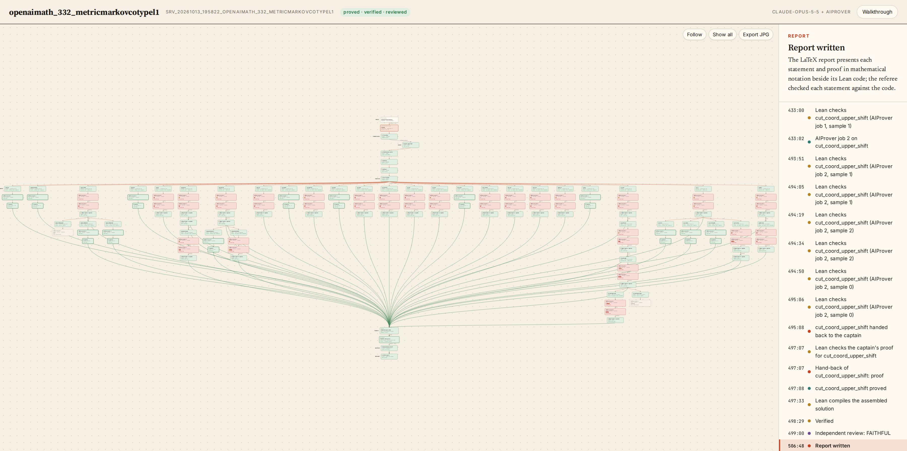
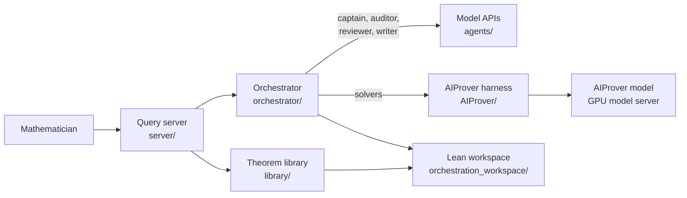
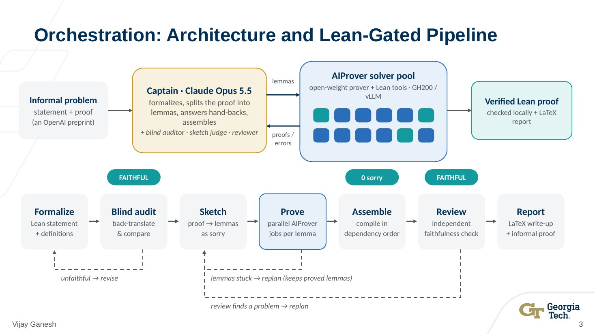
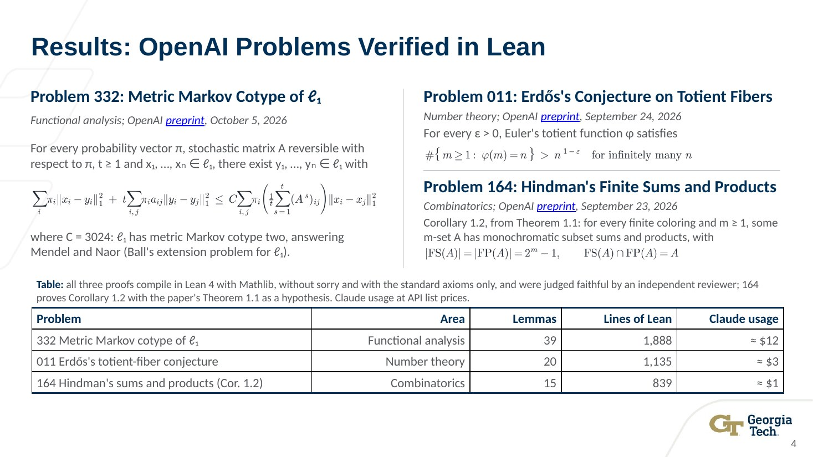
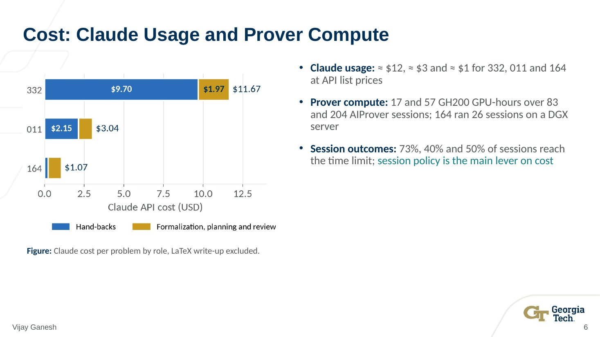

# AIProver orchestration

Tools for mathematicians to direct AI agents at their problems in Lean 4. An
orchestrator formalizes a problem, has the formalization audited blind,
decomposes the proof into lemmas and proves them with Claude and the AIProver
model; a theorem library records what is formalized and proved; a query
server exposes both over HTTP. All verification is local and sandboxed (Lean
v4.23.0, Mathlib v4.23.0, `autoImplicit false`).

| Section | Contents |
| --- | --- |
| [1. Running locally](#1-running-locally) | Setup with Nix, Claude on a subscription, the query server and single runs |
| [2. Running as a Claude Code skill](#2-running-as-a-claude-code-skill) | The `aiprover-captain` skill, with the session's agent as captain |
| [3. Using a running server](#3-using-a-running-server) | Submitting problems to the orchestration VM over SSH, without setup |
| [4. Layout](#4-layout) | Repository structure and components |
| [5. Pipeline](#5-pipeline) | The stages of a run |
| [6. Results](#6-results) | Problems proved, with cost |
| [7. Configuration](#7-configuration) | Model backends, GPU groups, server pages |
| [8. Future work](#8-future-work) | Planned extensions |



*Figure 1. Trace of the completed run on OpenAIMath 332.*

## 1. Running locally

This is how the orchestration VM runs: a query server queues problems and
runs each as an orchestrator process; Claude runs on a Claude subscription
and AIProver on a model server. Linux, WSL2 or macOS, about 15 GB of disk.

**Setup (Nix, once per machine).** `./setup` installs Nix if needed (after
confirmation; sudo once, to create `/nix`), builds the tools and AIProver
virtualenvs into `aiprover/nix/`, builds the Lean project and connects the
model server (`--dry-run` prints the steps):

```bash
git clone --recurse-submodules https://github.com/Logan-Cole-Luna/aiprover-orchestration aiprover_orchestration
cd aiprover_orchestration
./setup --endpoint http://<host>:<port>   # the AIProver model server; none: Claude only
nix develop                               # a shell with the tools on PATH
```

**Within the central repository.** The orchestration is a submodule of
[AIProver](https://github.com/Logan-Cole-Luna/AIProver), which pins it together
with the harness and sets up both (`nix run .#setup-orchestration`). There,
`./setup --harness PATH` uses the harness checkout at `PATH` in place of the
`AIProver/` submodule; the choice is kept as the link `aiprover/harness`, and
`$AIPROVER_HARNESS` overrides it for one process. `--no-plugin` leaves the
plugin installation to the central repository's marketplace.

**Claude on a subscription.** Install [Claude Code](https://claude.com/claude-code),
run `claude` once and log in with `/login` using a Pro or Max account.
With `ANTHROPIC_API_KEY` unset, every Claude role runs through the logged-in
`claude` CLI and its subscription (`CLAUDE_AUTH=subscription` forces this).
Check the login and the models:

```bash
aiprover/nix/tools/bin/python3 -m aiprover_orchestration.agents.claude_cli --probe claude-opus-5-5
```

When the subscription's usage limit is reached, the call waits for the reset
and retries; the run continues.

**Query server.** Start it and open http://127.0.0.1:8443/dev (Ctrl+C
stops it; choose another `--port` when 8443 is in use):

```bash
aiprover/nix/tools/bin/python3 -m uvicorn aiprover_orchestration.server.app:app --host 127.0.0.1 --port 8443 --workers 1
```

To keep it running, install the systemd user unit in `scripts/systemd/`;
`systemctl --user restart aiprover_query_server` loads a code change, and
runs in progress continue.

**Single runs and tools**, from the repository root:

```bash
# One orchestration run, and its resumption
aiprover/nix/tools/bin/python3 -m aiprover_orchestration.orchestrator.run \
    --config configs/orchestrator/claude.json \
    --dataset data/openai_math.jsonl \
    --problem-uuid OpenAIMath_164_HindmanDistinctExpressions
aiprover/nix/tools/bin/python3 -m aiprover_orchestration.orchestrator.run --run-id <run_id> --resume

# Theorem library
aiprover/nix/tools/bin/python3 -m aiprover_orchestration.library verify NAME FILE [--disprove]

# Trace pages of a run
aiprover/nix/tools/bin/python3 -m aiprover_orchestration.orchestrator.trace_view results/<run_id>/trace.json

# Tests (about 2 min; those that need Lean are skipped without it)
aiprover/nix/tools/bin/python3 -m unittest discover -s tests -t .
```

The commands use the interpreter that `./setup` builds,
`aiprover/nix/tools/bin/python3`; within `nix develop`, `python3` is the same
interpreter. Another Python, such as conda's, lacks the packages
(`ModuleNotFoundError: No module named 'anthropic'`). Without Nix, the requirements
are elan with Lean v4.23.0, the Mathlib project linked by
`orchestration_workspace/`, Python 3.12 with `fastapi`, `uvicorn`,
`aiohttp`, `pygments`, `anthropic` and `psutil`, and `pdflatex`.

## 2. Running as a Claude Code skill

The `aiprover-captain` skill runs the orchestration inside Claude Code, with
the session's agent as captain. Lean runs on the user's machine; lemmas are
proved by AIProver jobs on a model server, or by Claude subagents without
one. The same `./setup` also installs the plugin:

```bash
./setup --endpoint none                          # Claude only
./setup --endpoint http://<host>:<port>          # AIProver model server
```

| Model server | Option |
| --- | --- |
| none | `--endpoint none` |
| reachable from this device | `--endpoint URL [--api-key KEY]` |
| reachable through an SSH host | `--endpoint URL --via HOST [--user USER]` |
| a cluster job that writes `node=<n> port=<p>` to a file | `--via HOST --handoff FILE` |

The harness reaches the server through a local reasoning proxy, directly or
over an SSH tunnel. `orchestration_plugin/setup.sh` has the steps `connect`,
`endpoint`, `stop`, `doctor`, `claude` (reinstall the plugin) and `lean`;
see [orchestration_plugin/README.md](orchestration_plugin/README.md).

Restart Claude Code, open the repository and ask, for example:

```
/aiprover-orchestration:aiprover-captain Run OpenAIMath_011_TotientFibersFromSmoothShiftedPrimes from data/openai_math.jsonl
```

or paste `<informal_theorem>…</informal_theorem>` and
`<informal_proof>…</informal_proof>`. A run takes hours; its record is
written to `results/<slug>_skill_<date>/`.

## 3. Using a running server

A query server on a host (section 1) can be used without any setup. Its
runs use the submitting user's own Claude subscription; therefore each user
runs a server of their own on the host, under their own account. With an
account on the host, one command from the user's own machine signs in to
Claude on first use, starts the server, and forwards its page:

```bash
ssh -t -L PORT:127.0.0.1:PORT <user>@<host> \
    /home/loganluna/workspace/aiprover_orchestration/scripts/user/aiprover-server serve
```

`PORT` is fixed per account (20000 + 2 × (uid mod 5000)); on the host,
`aiprover-server ssh` prints the complete command. On first use the command
runs `claude auth login`, which prints Anthropic's sign-in link; the sign-in
completes in the browser on Anthropic's site, and the login is kept in the
user's `~/.claude` on the host. No Claude credential passes through the
page or the server. Then open `http://localhost:PORT/user`; Ctrl+C closes the
connection, while the server and its runs continue (`aiprover-server stop`
ends the server). Pro and Max limits assume individual use, which long runs
exhaust quickly.

Concurrency is bounded per machine, across runs and users: hosted model calls,
Lean processes, and AIProver sessions wait for slots whose number follows from
the machine's memory and processors. `AIPROVER_MAX_HOSTED`, `AIPROVER_MAX_TOOL_CALLS`, `AIPROVER_MAX_LEAN`,
`AIPROVER_MAX_SESSIONS`, and `AIPROVER_LEAN_MB` (for checks; builds use 8192 MB)
replace the derived limits.

The page submits an informal statement and proof, or a problem of the open
and OpenAI math datasets, and lists the proved OpenAI problems and the runs
submitted from it with their Lean files, reports, and traces. A cancelled or
unproved run has a Resume button that continues it from its trace. Import
run adds a run started elsewhere from a zip of its `results/<run_id>/` folder
or of its export. A run takes an optional name, which becomes its id. The
form's "Orchestrator settings" set a run's hand-backs, retries, attempts, and
Claude budget, among others.

## 4. Layout



```
├── aiprover_orchestration/     # Python package
│   ├── lean/                   #   Lean checks, sandbox, module builds
│   ├── agents/                 #   model backends and the routing pool
│   ├── library/                #   theorem library: store, verifier, CLI, HTTP API
│   ├── orchestrator/           #   formalize → audit → sketch → prove → assemble
│   └── server/                 #   query server, job worker, reasoning proxy
├── orchestration_plugin/       # Claude Code skill aiprover-captain
├── setup, flake.nix, nix/      # one-command setup (Nix)
├── configs/                    # run, harness and server configurations
├── orchestration_workspace/    # Lake project of library and run modules
├── AIProver/                   # AIProver harness and prover (submodule; see --harness)
├── data/                       # problem datasets (openai_math.jsonl in git)
├── results/                    # run records (Lean, report, informalization)
└── docs/                       # slides and figures
```

## 5. Pipeline



*Figure 2. Architecture and pipeline.*

The captain (Claude) formalizes the problem; a blind auditor translates the
Lean back to mathematics for comparison with the source; the captain
sketches the proof as lemmas, which AIProver jobs attempt in parallel; stuck
lemmas return to the captain to prove, split or restate; the verified
solution is assembled, reviewed independently and written up in LaTeX. Lean
gates every stage.

## 6. Results

| Problem | Status | Lemmas | Final review |
| --- | --- | --- | --- |
| OpenAIMath 332, metric Markov cotype of L1 | proved (2026-10-14) | 39 | faithful |
| OpenAIMath 011, large totient fibers, conditional on (H) | proved (2026-10-11) | 20 | faithful |
| OpenAIMath 164, Hindman FS+FP, Corollary 1.2 from Theorem 1.1 | proved (2026-10-15) | 15 | faithful |



*Figure 3. OpenAI problems verified in Lean.*



*Figure 4. Claude cost and prover compute per problem.*

Run records are in `results/<run_id>/`: Lean files, summary, report and
informalization; traces and server metrics are kept out of the repository
for size. Slides on these results:
[docs/slides/aiprover_orchestration_openai_math.pptx](docs/slides/aiprover_orchestration_openai_math.pptx).

## 7. Configuration

Each role of a run config names a backend: `claude`, `openai_compatible` (a
local server or a hosted provider: `openai`, `huggingface`, `openrouter`),
or `aiprover` (solver only). `claude` uses the subscription of the
logged-in `claude` CLI, or the Anthropic API when `ANTHROPIC_API_KEY` is
set (`CLAUDE_AUTH=subscription|api` overrides).

A GPU group names the model server that runs a run's AIProver jobs. Group
`cpu` needs none (every role on Claude or a hosted model). The other groups
use the endpoint written by `./setup --endpoint <URL>`
(`orchestration_plugin/aiprover.toml`) and its reasoning proxy
(`orchestration_plugin/setup.sh endpoint` restarts the proxy after a
reboot), or a harness configuration in `configs/aiprover/`.

The server has two pages. `/user`, where `/` leads, offers one GPU group,
the open and OpenAI math problems, the proved OpenAI problems, and the runs
submitted from it. `/dev` offers every GPU group, model and dataset and
lists every run; an API call without `?page=dev` is the user page's. The
pages scope what is offered; they are not access control. Access is open;
`QUERY_SERVER_AUTH=on` requires tokens (`configs/server/tokens.example.json`)
and approval.

## 8. Future work

- Import of an existing Lean project (declaration graph, stubs, original
  proofs as sketches).
- Orchestrator runs that read and extend the theorem library.
- Missions and milestones; several pinned Lean environments.
