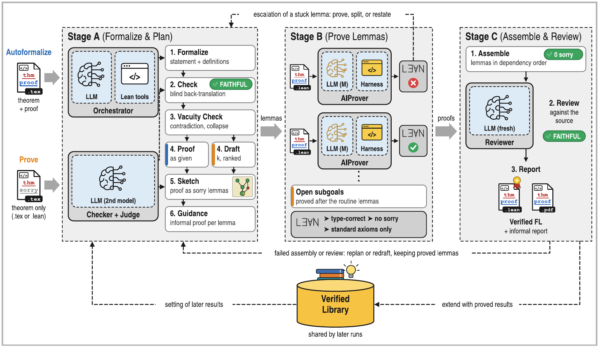
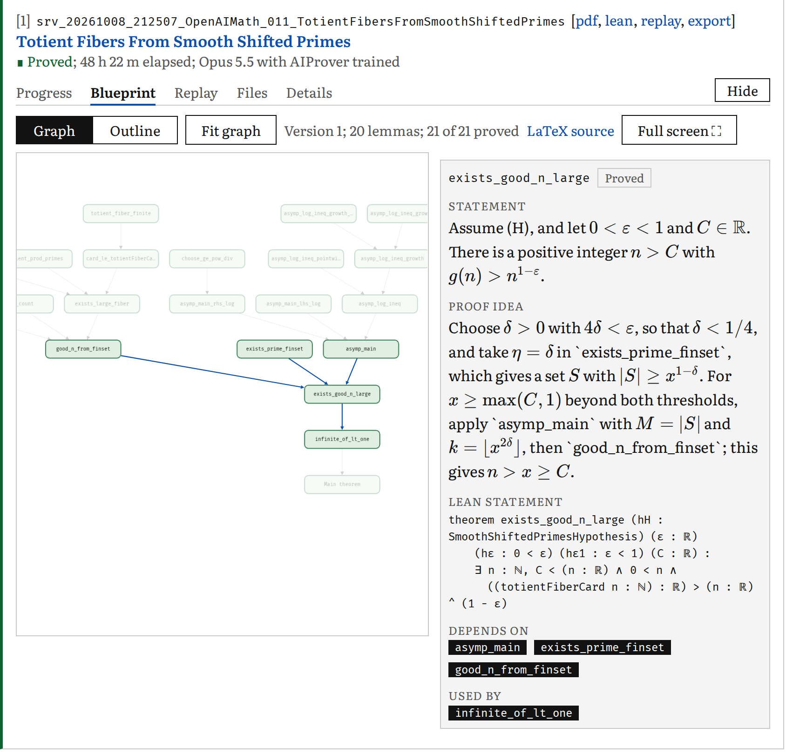
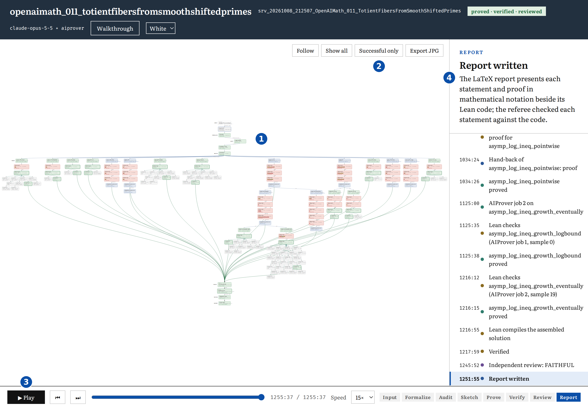
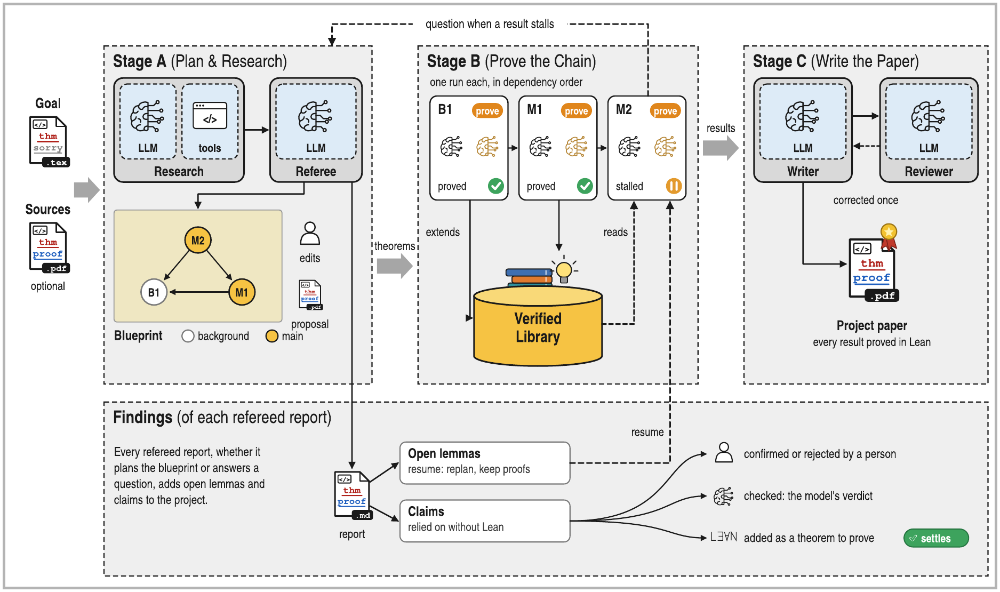
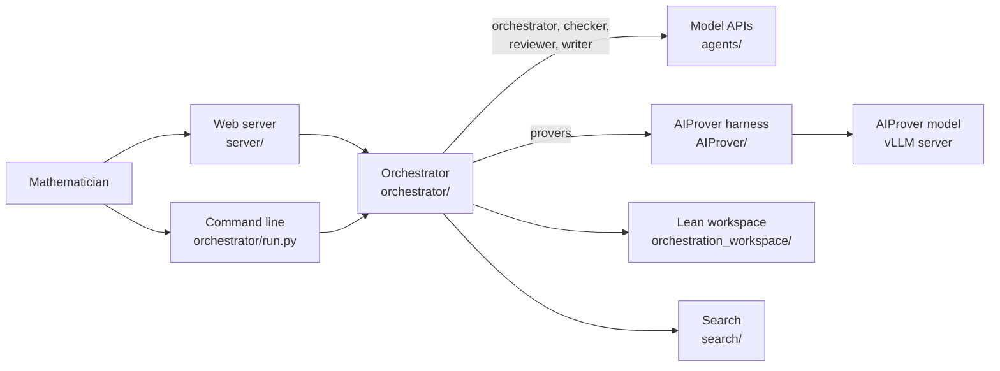

# AIProver orchestration

This repository provides an orchestration that produces verified Lean 4
proofs of mathematical theorems. Given a theorem, with or without a proof, an
orchestrating model formalizes the statement, decomposes the proof into
lemmas, and assigns the lemmas to the AIProver model, intervening only when a
lemma resists repeated attempts. The output is a Lean proof together with a
LaTeX report and an informal proof.

The formal statement is translated back into mathematics without access to
the source, compared with the source by a judge, and tested by Lean for
vacuous hypotheses and counterexamples; consequently, a proof is accepted
only for a statement that matches the source. Lean checks every step in a
sandbox, and the finished proof contains no `sorry` and uses only the
standard axioms, after which an independent reviewer referees it against the
source. The hosted model plans the proof and resolves difficult lemmas,
whereas routine proving runs on the AIProver model on the user's own
hardware, which keeps the cost per theorem low. Libraries and projects carry
proved results into later runs, and every run is recorded as a trace from
which it resumes after an interruption and can be replayed step by step.
[The orchestration](docs/guide/orchestration.md) describes the design in
detail. The web server and the command line run the same pipeline, on Lean
v4.23.0 and Mathlib v4.23.0.

| Section | Contents | Guide |
| --- | --- | --- |
| [1. Setup](#1-setup) | Installation, model server, search, services | [setup](docs/guide/setup.md) |
| [2. Web server](#2-web-server) | Runs, blueprints, projects on the page | [web server](docs/guide/web_server.md) |
| [3. Command line](#3-command-line) | The same runs and projects without the server | [command line](docs/guide/command_line.md) |
| [4. Claude Code skill](#4-claude-code-skill) | The session's agent as orchestrator | [plugin](orchestration_plugin/README.md) |
| [5. Layout](#5-layout) | Repository structure | |
| [6. Configuration](#6-configuration) | Backends, deployment settings, limits | [configuration](docs/guide/configuration.md) |



*Figure 1. One run: formalize and plan (A), prove the lemmas with AIProver,
escalating stuck ones to the orchestrator (B), then assemble, review, and
report (C). Proved results extend a shared library.*

## 1. Setup

Linux, WSL2, or macOS, with about 15 GB of disk. `./setup` installs Nix if
needed, builds the tools and the Lean project, and connects the AIProver
model server ([setup guide](docs/guide/setup.md)):

```bash
git clone --recurse-submodules https://github.com/Logan-Cole-Luna/aiprover-orchestration aiprover_orchestration
cd aiprover_orchestration

./setup --endpoint http://<host>:<port> --search   # connect an AIProver model server; download the arXiv index
./setup --endpoint none                            # no model server: hosted models in every role
./setup --endpoint http://<node>:<port> --via HOST # a server reachable only through an SSH host
./setup --endpoint http://<host>:<port> --no-lean  # change the server only
claude                                             # once, then /login: hosted roles use this subscription
scripts/systemd/install aiprover_query_server aiprover_paper_search   # run the web server and paper search as services
```

| Option | Effect |
| --- | --- |
| `--endpoint URL\|none` | The AIProver model server, or none |
| `--via HOST`, `--handoff FILE` | Reach the server through an SSH host; follow a cluster job's node and port in a file there |
| `--search` | Download the arXiv index for `paper-search` (1.6 GB) |
| `--no-lean` | Skip the Lean build and the plugin installation |
| `--dry-run` | Print the steps and change nothing |

The AIProver model is served with vLLM
(`AIProver/AIProver_plugin/serve/serve_aiprover.sh <checkpoint>`); its FP8
weights, about 112 GB and not in this repository, need well over 112 GB of
GPU memory.

## 2. Web server

```bash
aiprover/nix/tools/bin/python3 -m uvicorn aiprover_orchestration.server.app:app --port 8443
```

Open http://127.0.0.1:8443/dev ([web server guide](docs/guide/web_server.md)). The page submits an informal statement and
proof, a Lean statement, or a dataset problem; chooses a model per role and
whether to formalize the given proof or prove the theorem; and sets the
orchestrator's settings. Runs show their progress, blueprint (Figure 2),
replay (Figure 3), Lean files, and reports, and can be resumed. The Guide tab
explains the page to readers new to Lean.



*Figure 2. Blueprint of a proved run: its lemmas as a dependency graph, with
the statement, proof idea, and Lean statement of the selected one.*



*Figure 3. Replay of a run: every stage, job, and session, with its events.*

A project proves the results of one subject as a chain on a shared library
(Figure 4). Research sessions plan the chain and report open lemmas and
claims, each result is then proved by its own run, and the results are
finally written up as a paper.



*Figure 4. A project: plan and research, prove the chain, write the paper.*

On a shared host, each user runs a server of their own:
`ssh -t -L PORT:127.0.0.1:PORT <user>@<host> <checkout>/scripts/user/aiprover-server serve`
(`aiprover-server ssh` prints the command), then opens
`http://localhost:PORT/user`.

## 3. Command line

The command line runs the same pipeline as the page and writes the same
records to `results/<run_id>/` ([command line guide](docs/guide/command_line.md)
lists every option):

```bash
PY=aiprover/nix/tools/bin/python3
RUN="$PY -m aiprover_orchestration.orchestrator.run --config configs/orchestrator/standard.json"

$RUN --statement statement.tex --proof proof.tex --run-id my_result   # formalize a given theorem and proof
$RUN --statement statement.tex --mode prove --run-id my_result        # prove a theorem without a given proof
$RUN --dataset data/openai_math.jsonl --problem-uuid <uuid>           # a problem from a dataset
$PY -m aiprover_orchestration.orchestrator.run --run-id my_result --resume   # continue a stopped run
$PY -m aiprover_orchestration.orchestrator.project run <name> --config configs/orchestrator/standard.json   # prove a project's results in order
```

| Flag | Effect |
| --- | --- |
| `--config FILE` | Models of each role: `standard.json` (the page's defaults) or `claude.json` (hosted models only) |
| `--mode prove` | Withhold any given proof and prove the theorem |
| `--library FILE --extend-library true` | Build on a library of earlier results, and add the proved result to it |
| `--paper-search true` | Let the orchestrator search arXiv and read papers |
| `--max-hosted-usd X` | Budget of hosted-model spending for the run |

## 4. Claude Code skill

`./setup` also installs the `aiprover-orchestrator` skill, which runs the
orchestration inside Claude Code with the session's agent as orchestrator.
Open the repository and ask, for example,
`/aiprover-orchestration:aiprover-orchestrator Run OpenAIMath_011_TotientFibersFromSmoothShiftedPrimes from data/openai_math.jsonl`
([orchestration_plugin/README.md](orchestration_plugin/README.md)).

## 5. Layout



| Path                        | Contents                                                   |
| --------------------------- | ---------------------------------------------------------- |
| `aiprover_orchestration/` | agents, Lean checks, library, orchestrator, search, server |
| `configs/`                | run, harness, and server configurations                    |
| `scripts/`                | systemd units, per-user server, guide export               |
| `orchestration_plugin/`   | the Claude Code skill                                      |
| `AIProver/`               | AIProver harness and prover (submodule)                    |
| `data/`, `results/`     | problem datasets; run records                              |

## 6. Configuration

Each role of a run config (`configs/orchestrator/*.json`) names a backend:
`claude`, `codex`, `openai_compatible` (any server with that API), or
`aiprover` (prover only). A deployment's own settings, such as its model
servers, a Slurm cluster, and hardware rates, lie in the untracked
`configs/site.json` (`configs/site.example.json` lists them); without it, the
page uses `standard.json` and the model server that `./setup` connects. The
[configuration guide](docs/guide/configuration.md) covers both, and the limits
and access settings.
