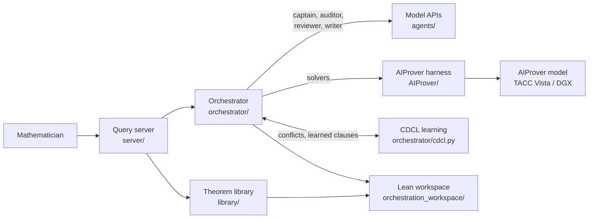

# AIProver orchestration

Tools for mathematicians to direct AI agents at their problems in Lean 4. An
orchestrator formalizes a problem, has the formalization audited blind,
decomposes the proof into lemmas and proves them with Claude and the AIProver
model; a theorem library records what is formalized and proved; a query
server exposes both over HTTP. Failures are learned from as a CDCL solver
learns from conflicts: stuck lemmas trigger a conflict analysis whose learned
clauses reach every later job, and a backjump restates the decision that
caused them. All verification is local and sandboxed (Lean v4.23.0, Mathlib
v4.23.0, `autoImplicit false`).



## Layout

```
├── aiprover_orchestration/     # Python package
│   ├── lean/                   #   Lean checks, module builds, source parsing
│   ├── agents/                 #   model backends and the routing pool
│   ├── library/                #   theorem library: store, verifier, CLI, HTTP API
│   ├── orchestrator/           #   formalize → audit → sketch → prove → assemble
│   └── server/                 #   query server, job worker, reasoning proxy
├── orchestration_plugin/       # Claude Code skill aiprover-captain
├── setup, flake.nix, nix/      # one-command setup of the skill (Nix)
├── configs/                    # run, harness and server configurations
├── orchestration_workspace/    # Lake project of library and run modules
├── AIProver/                   # AIProver harness and prover (submodule)
├── data/                       # problem datasets (openai_math.jsonl in git)
├── results/                    # run records (trace, Lean, report)
└── slides/                     # talk slides on the OpenAI math results
```

Work log: [logbook.md](logbook.md).

## Submitting problems without setup

The query server on the orchestration VM runs problems on the DGX. With an
account on the VM (its address `<vm-host>` comes with the account), forward
its port and open the page in a browser:

```bash
ssh -N -L 8443:localhost:8443 <user>@<vm-host>
```

Then open http://localhost:8443 (it leads to `/user`); the `ssh` command
holds the connection until Ctrl+C. When 8443 is in use on the local machine,
forward another local port (`-L 8450:localhost:8443`, then
http://localhost:8450). The page submits an informal statement and proof, or
a problem of the open and OpenAI math datasets, and lists the runs submitted
from it with their Lean files, reports and traces.

## Setup: the aiprover-captain skill

The skill runs the orchestration from Claude Code with the session's agent
as captain. Lean runs on the user's machine; lemmas are proved by AIProver
jobs on a model server, or by Claude subagents without one. Linux, WSL2 or
macOS, about 15 GB of disk:

```bash
git clone --recurse-submodules https://github.com/Logan-Cole-Luna/aiprover-orchestration aiprover_orchestration
cd aiprover_orchestration
./setup --endpoint none                          # Claude only
./setup --endpoint http://<host>:<port>          # AIProver model server
```

`./setup` installs Nix if needed (after confirmation; the installer needs
sudo once per machine, to create `/nix`), builds the tools and
the AIProver virtualenvs, writes the device's configuration, builds the Lean
project and installs the plugin. `--dry-run` prints the steps.

| Model server                                              | Option                                      |
| --------------------------------------------------------- | ------------------------------------------- |
| none                                                      | `--endpoint none`                         |
| reachable from this device                                | `--endpoint URL [--api-key KEY]`          |
| reachable through an SSH host                             | `--endpoint URL --via HOST [--user USER]` |
| a cluster job that writes `node=<n> port=<p>` to a file | `--via HOST --handoff FILE`               |

The harness reaches the server through a local reasoning proxy, directly or
over an SSH tunnel. `orchestration_plugin/setup.sh` has the steps `connect`
(SSH login), `endpoint` (tunnel and proxy), `stop`, `doctor`, `claude`
(reinstall the plugin) and `lean`; details in
[orchestration_plugin/README.md](orchestration_plugin/README.md).

To run, restart Claude Code, open the repository and ask, for example:

```
/aiprover-orchestration:aiprover-captain Run OpenAIMath_011_TotientFibersFromSmoothShiftedPrimes from data/openai_math.jsonl
```

or paste `<informal_theorem>…</informal_theorem>` and
`<informal_proof>…</informal_proof>`. A run takes hours; its record is
written to `results/<slug>_skill_<date>/`.

## Usage

Commands use the Python of `./setup`'s environment, from the repository
root (another Python, such as conda's, lacks the packages):

```bash
# One orchestration run, and its resumption
aiprover/nix/tools/bin/python3 -m aiprover_orchestration.orchestrator.run \
    --config configs/orchestrator/claude.json \
    --dataset data/openai_math.jsonl \
    --problem-uuid OpenAIMath_164_HindmanDistinctExpressions
aiprover/nix/tools/bin/python3 -m aiprover_orchestration.orchestrator.run --run-id <run_id> --resume

# Query server; then open http://127.0.0.1:8443/dev in a browser (Ctrl+C stops it)
aiprover/nix/tools/bin/python3 -m uvicorn aiprover_orchestration.server.app:app --host 127.0.0.1 --port 8443 --workers 1

# Theorem library
aiprover/nix/tools/bin/python3 -m aiprover_orchestration.library verify NAME FILE [--disprove]

# Trace pages of a run
aiprover/nix/tools/bin/python3 -m aiprover_orchestration.orchestrator.trace_view results/<run_id>/trace.json

# Tests (about 2 min; those that need Lean are skipped without it)
aiprover/nix/tools/bin/python3 -m unittest discover -s tests -t .
```

Each role of a run config names a backend: `claude`, `openai_compatible`
(a local server or a hosted provider: `openai`, `huggingface`,
`openrouter`), or `aiprover` (solver only). `claude` uses the Claude
subscription of the logged-in `claude` CLI, or the Anthropic API when
`ANTHROPIC_API_KEY` is set (`CLAUDE_AUTH=subscription|api` overrides).

The query server queues submissions and runs them as orchestrator processes;
choose another `--port` when 8443 is in use (for example by an editor that
forwards a remote server's port).
GPU group `cpu` needs no model server (every role on Claude or a hosted
model). In a checkout set up with `./setup --endpoint dgx`, GPU group `dgx`
uses that checkout's `orchestration_plugin/aiprover.toml` and reasoning proxy
(`orchestration_plugin/setup.sh endpoint` restarts the proxy after a reboot);
`configs/aiprover/dgx.toml` serves the deployment it names. Access is open;
`QUERY_SERVER_AUTH=on` requires tokens
(`configs/server/tokens.example.json`) and approval. A systemd user unit is
in `scripts/systemd/`; `systemctl --user restart aiprover_query_server`
loads a code change, and runs in progress continue.

The server has two pages. `/user`, where `/` leads, offers GPU group `dgx`,
the open and OpenAI math problems, and the runs submitted from it. `/dev`
offers every GPU group, model and dataset and lists every run. The server
enforces the user page's limits, and an API call without `?page=dev` is
the user page's. The pages scope what is offered; they are not access
control.

`./setup` provides Lean, Mathlib and these Python packages; without it,
the requirements are elan with Lean v4.23.0, the Mathlib project linked by
`orchestration_workspace/`, Python 3.12 with `fastapi`, `uvicorn`,
`aiohttp`, `pygments`, `anthropic` and `psutil`, and `pdflatex`.

## Results

| Problem                                                       | Status              | Lemmas | Final review |
| ------------------------------------------------------------- | ------------------- | ------ | ------------ |
| OpenAIMath 332, metric Markov cotype of L1                    | proved (2026-10-14) | 39     | faithful     |
| OpenAIMath 011, large totient fibers, conditional on (H)      | proved (2026-10-11) | 20     | faithful     |
| OpenAIMath 164, Hindman FS+FP, Corollary 1.2 from Theorem 1.1 | proved (2026-10-15) | 15     | faithful     |

Run records are in `results/<run_id>/`. Slides on these results (method,
formalization, results, run trace, cost, future work):
[slides/aiprover_orchestration_openai_math.pptx](slides/aiprover_orchestration_openai_math.pptx).

## Future work

- Import of an existing Lean project (declaration graph, stubs, original
  proofs as sketches).
- Orchestrator runs that read and extend the theorem library.
- Missions and milestones; several pinned Lean environments.
