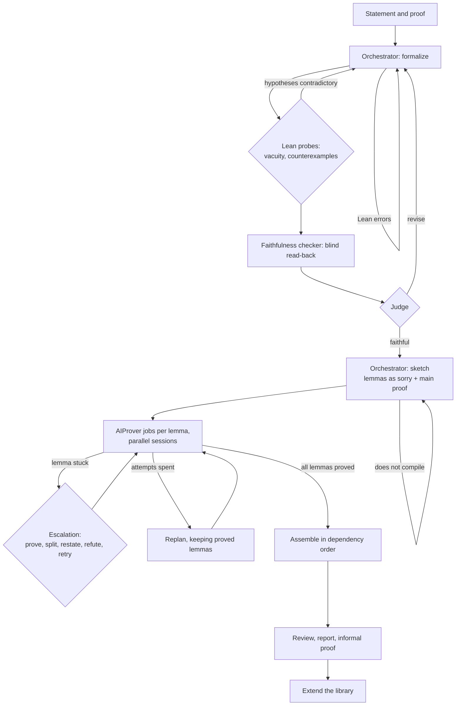

# The orchestration

A run takes a theorem, in natural language or in Lean, with or without a
proof, and returns a Lean 4 proof checked against a formal statement made in
the same run, with a LaTeX report and an informal proof. A hosted model
orchestrates; the AIProver model proves the lemmas; Lean checks every step.

## Roles

| Role | Responsibility |
| --- | --- |
| Orchestrator | Formalizes the problem, writes and revises the proof sketch, answers escalations |
| Faithfulness checker | Reads the Lean statement back into mathematics without seeing the source |
| Judge (optional) | Compares the read-back with the source, as a model other than the orchestrator's |
| Prover | AIProver: proves one lemma per job, in several independent agentic sessions with Lean tools |
| Reviewer | A fresh agent that referees the verified file against the source |
| Writer | Writes the report and the informal proof, statement by statement beside the Lean code |

Each role names its own backend and model (a hosted service, any
OpenAI-compatible server, or AIProver), so any model can fill any chat role.

## Pipeline

The run proceeds in four stages. In the first, the orchestrator writes the
definitions and the theorem in Lean. Lean then probes the hypotheses for
contradictions and the statement for counterexamples, a faithfulness checker
translates the Lean back into mathematics without seeing the source, and a
judge compares that translation with the source; a mismatch returns the
formalization to the orchestrator.

In the second stage, the orchestrator writes a sketch, that is, the main proof
in Lean with each step stated as a lemma whose proof is `sorry`, and the
sketch must compile. In prove mode, where no proof is given, the orchestrator
first drafts a proof of its own.

In the third stage, each lemma becomes a sequence of AIProver jobs, each of
which runs several independent sessions. A lemma that fails repeatedly is
escalated to the orchestrator, which proves it, splits it into smaller
lemmas, restates it, refutes it, or grants it further attempts. When a
lemma's attempts are exhausted, the orchestrator replans the proof while
keeping every lemma already proved.

In the final stage, the proved lemmas are assembled in dependency order. The
file must compile without `sorry` and use only the standard axioms, and a
separate check confirms that the type of the solution is exactly that of the
target. An independent reviewer then referees the result against the source,
and the writer produces the report and the informal proof.

## Verification

Every proposal from any model, the orchestrator's included, passes Lean
before it changes the run. A prover session counts only when its extracted
proof checks under the sketch's statement with the earlier lemmas as stubs.
Elaborating Lean can run code, so every check rejects constructs that run
code (`#eval`, `IO`, `unsafe`, and others) and runs under an operating-system
sandbox (Landlock on Linux, Seatbelt on macOS) with no network, writes only in
its project, and no credentials.

## Libraries and projects

A run may build on a library of verified results and add its own result to
it, so later runs cite earlier theorems instead of proving them again. A
project chains results of one subject on a shared library: research sessions
plan the chain and report open lemmas and claims, each result is proved by
its own run in dependency order, and the results are written up as one
paper. A claim, a statement relied on without a Lean proof, is settled only
by adding it as a theorem to prove.

## Records and resumption

Every step of a run is recorded in its trace: each model call with its
prompt, reply, tokens, and cost, each Lean check, and each AIProver job and
session. A run resumes from its trace after any interruption (a lost model
server, a restart, a budget reached) without losing a proved lemma or
counting an interrupted job as an attempt. The trace pages replay a run
stage by stage, and each run reports its hosted-model cost and the GPU time
of its prover sessions.

## Properties

The design rests on a small number of properties. First, the faithfulness of
the formal statement is verified explicitly: the statement is read
back without the source, judged against it, and probed by Lean, and the
finished proof is refereed by an agent that took no part in producing it.
Second, verification is local and complete, since the result compiles in Lean
without `sorry`, uses only the standard axioms, and matches the type of the
target in a separate check. Third, the cost of a run is concentrated where it
is needed: the hosted model plans and intervenes only on difficult lemmas,
whereas routine proving runs on the AIProver model on the user's own
hardware. Fourth, results accumulate, because libraries and projects carry
proved theorems into later runs. Finally, every run is recorded as a trace,
from which it resumes after an interruption and through which each decision
can be inspected. The web server and the command line run the same
orchestration and write the same records, and any model may serve any role.
