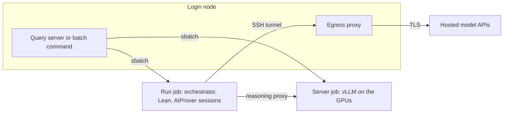

# Running on a Slurm cluster

A cluster can run the whole pipeline as Slurm jobs, from the login node. The model server is a GPU job, and each run is a CPU job of its own, so that Lean checks and AIProver sessions use compute nodes and the login node runs nothing heavy. Two interfaces share the same jobs: the query server, which submits the runs of its queue, and a batch command for one run at a time.



## Download the model

The weights of [prithwish-jana/aiprover-119b](https://huggingface.co/prithwish-jana/aiprover-119b) are about 112 GB, are public, and are not part of the repository. They are downloaded once on the login node, into a directory on a scratch file system, with the Hugging Face command line client, which `uvx` runs from the package manager `uv`. If `uv` is missing, it is installed first:

```bash
curl -LsSf https://astral.sh/uv/install.sh | sh
```

```bash
uvx --from "huggingface_hub[cli]" hf download prithwish-jana/aiprover-119b \
    --local-dir "$SCRATCH/aiprover_model"
```

The download can take hours, so it runs in `tmux` or under `nohup`. The path that was given to `--local-dir` is the value of `AIPROVER_MODEL` in `configs/slurm/site.env` (Step 1 of the installation).

## Requirements

The login node of the cluster needs Python 3.11 or later, `git`, `curl`, `uv`, and network access. The compute nodes need none, since every download happens on the login node. The cluster must provide a file system shared by the login and compute nodes, a node-local directory in `SLURM_TMPDIR`, and the commands `sbatch`, `squeue`, `sacct`, and `scancel`. The model server further needs the weights of a model in a directory.

## Installation

The installation is performed once, on the login node of a checkout, in three steps.

### Step 1: describe the site

The file `configs/slurm/site.env` is provided with empty values. Three of them are required.

| Variable | Meaning |
|---|---|
| `SBATCH_ACCOUNT` | The account that sbatch charges. |
| `AIPROVER_MODEL` | The directory of the model weights that the server job serves, the path of the download above. |
| `AIPROVER_GPUS` | The GPUs of the server job, written as sbatch writes them, for example `a100:4`. |

```bash
export SBATCH_ACCOUNT=def-example
export AIPROVER_MODEL=$SCRATCH/aiprover_model
export AIPROVER_GPUS=a100:4
```

The server job takes whole nodes with these GPUs. The code defines one GPU group for the model from these values, so that no further file is needed. A deployment that keeps its values out of the repository places an untracked `configs/site.env` beside the template, which replaces it.

### Step 2: run the setup script

The virtual environments and the package cache are written to `$SCRATCH` when it is set, because they hold many small files and a home directory often has a small file quota.

```bash
mkdir -p temp
nohup bash scripts/slurm/setup.sh > temp/setup.log 2>&1 &
tail -f temp/setup.log
```

The script runs detached, so that a lost connection does not stop it. It creates the virtual environments, including one with vLLM for the model, fetches the harness and the Lean project with the prebuilt files of Mathlib, and then submits CPU jobs that build the Lean project and pack it. Each completed step is skipped when the script runs again.

A pack is a set of tar shards, made by `scripts/slurm/pack.sh`, that a job extracts to node-local disk. Shared file systems serve a few large files much faster than the many small files of Mathlib, so a run job works on its extracted copy.

Three options add optional components. A client is installed only on request, because the roles of a run may use any provider.

| Option | Effect |
|---|---|
| `--claude` | Installs the `claude` command line client. |
| `--codex` | Installs the `codex` command line client, which needs Node.js. |
| `--search` | Builds the environment of the paper search and downloads its arXiv index. |

```bash
bash scripts/slurm/setup.sh --claude --codex --search
```

The jobs have finished when `squeue --me` lists none of them.

```bash
squeue --me
```

### Step 3: log in to the hosted providers

This step applies only to runs with hosted roles. Each client is logged in once on the login node, or the provider's API key is set in the environment.

```bash
claude        # then /login
codex login
```

The run job executes the client on its compute node, which shares the home directory and therefore the login. The client reaches the provider through the SSH session of the run job. Runs whose roles all use the AIProver server need no client.

### Another Lean release

The pinned Lean release is installed by `setup.sh`. A run can use another release, which is installed together with the Mathlib, REPL, and cslib that fit it, because a Mathlib release fits one Lean release only. The script `scripts/slurm/lean_release.sh` takes either a release that the packages support or a link that contains a release name, such as the page of a release on GitHub.

```bash
bash scripts/slurm/lean_release.sh list
bash scripts/slurm/lean_release.sh v4.34.1
bash scripts/slurm/lean_release.sh https://github.com/leanprover/lean4/releases/tag/v4.34.1
```

Compute nodes have no network, so the script downloads on the login node, and CPU jobs then build the release and pack it for the nodes. A release takes about 16 GB, and the script places it on `$SCRATCH` when that variable is set. The jobs have finished when `squeue --me` lists none of them, and a run selects the release with `--lean-release v4.34.1`. Without that option, a run uses the pinned release.

## Configuration files

Four files are edited by a user. They differ in scope, and the first two describe the cluster, whereas the last two describe a run.

| File | Content | Edited |
|---|---|---|
| `configs/slurm/site.env` | The account, the model directory, and the GPUs of the server job. | Once per site. |
| `configs/site.json` | Several GPU groups, a chat model, and GPU prices (optional). | Once per site. |
| `configs/orchestrator/*.json` | The model of each role and the options of a run. | Per experiment. |
| `configs/aiprover/slurm.toml` | The settings of the AIProver harness, such as its paths and session limits. | Rarely. |

The first two files are described in "Installation" and "Adapting to a site". The last file names the paths that `env.sh` sets and normally stays as provided.

### Run configurations

A run configuration is a JSON file that the option `--config` selects. It consists of an `agents` object, which assigns a model to each role, and the main options of the run as keys beside it. Both are edited in the file, so that a change of a model or of a limit needs no command line option. Five configurations are provided, and a new one is made by copying the closest and editing the copy. Each file explains its roles, the fields of a role, and every option in keys that start with an underscore, which are comments and are ignored when the file is read.

| File | Orchestrator, checker, reviewer, and writer | Prover |
|---|---|---|
| `default.json` | Claude | AIProver |
| `aiprover.json` | AIProver | AIProver |
| `claude.json` | Claude | Claude |
| `codex.json` | Codex | Codex |
| `codex_aiprover.json` | Codex | AIProver |

The file `default.json` is the default because the hosted roles plan, audit, and review, which needs the strongest models, whereas the many Lean attempts on each lemma are made by the prover, which is the AIProver model on the GPUs of the site. It is the configuration of the page, of a run without `--config`, and of the examples in this guide. The file `aiprover.json` needs no hosted account, and the files with `claude` or `codex` in the name need the client of that provider.

```json
{
  "agents": {
    "orchestrator": {"backend": "claude", "model": "claude-opus-5-5", "effort": "high", "tools": true},
    "checker": {"backend": "claude", "model": "claude-sonnet-5-5"},
    "reviewer": {"backend": "claude", "model": "claude-opus-5-5"},
    "writer": {"backend": "claude", "model": "claude-opus-5-5"},
    "prover": {"backend": "aiprover", "model": "aiprover", "config": "orchestration_plugin/aiprover.toml"}
  },
  "workers": 2,
  "max_repairs": 4,
  "max_hosted_usd": 50
}
```

The roles are the orchestrator (formalization and planning), the checker (audits of the statement), the prover (the AIProver jobs on the lemmas), the reviewer (the referee of the verified file), and the writer (the report). The fields of a role are as follows.

| Field | Meaning |
|---|---|
| `backend` | `claude` or `codex` (the provider's client), `openai_compatible` (any server with that API), or `aiprover` (the harness). |
| `model` | The model name. For the AIProver server it is the served name `aiprover`. |
| `base_url` | The address of an `openai_compatible` role. The address `http://127.0.0.1:18575/v1` names the model server of the default group, and the run job replaces it with the address of its own reasoning proxy. An address outside the cluster calls that host through the egress session. |
| `group` | The name of a GPU group of `site.json` whose server hosts the model of an `openai_compatible` role. |
| `api_key_file` | The absolute path of a file with the key of an external API. |
| `tools` | Whether the role may use the Lean tools. They are on for the orchestrator of the hosted backends and off otherwise. |
| `effort` | The reasoning effort of a hosted Claude role. |
| `timeout`, `max_output_tokens` | The limits of one call, in seconds and tokens. |
| `config`, `max_turns` | For the prover: the harness configuration and the turns of a session. |
| `phases` | Overrides for the phases whose names start with a given prefix, for example a smaller model for the `judge` phase. |

The main options of a run are keys of the same file. Every provided configuration lists them with their values, so that they are found and edited there, and the command line options after `--` override them for one run.

| Option | Meaning |
|---|---|
| `mode` | `autoformalize` translates the informal proof of the problem, and `prove` searches for a proof. |
| `workers` | Parallel prover chains per lemma. |
| `max_repairs`, `max_replans`, `max_audit_rounds` | Rounds of Lean error feedback per chain, of sketch revisions, and of formalization revisions. |
| `lean_parallel`, `lean_timeout` | Concurrent Lean checks of the run and the time limit of one check, in seconds. |
| `max_hosted_calls`, `max_hosted_usd` | Limits on the calls to hosted models (0 is unlimited) and on their cost in USD. |
| `aiprover_attempts_per_lemma` | Failed attempts allowed per lemma statement. |
| `aiprover_session_slots`, `aiprover_job_sessions` | AIProver sessions that share one model server, and sessions of one job. |
| `aiprover_escalation_after`, `max_escalations` | Failed jobs after which a lemma goes back to the orchestrator, and the escalations per run. |
| `library` | A library of verified results to build on (empty for none). |

The complete list, with the default of every option not written in the file, is the class `Config` in `aiprover_orchestration/orchestrator/config.py`. An option missing from a file takes that default, and a key can be added to a file at any time.

An orchestrator hosted by an external OpenAI-compatible API names its address and key. The host of the address is the only one that the egress session then allows besides the hosts of the other roles.

```json
"orchestrator": {
  "backend": "openai_compatible", "model": "MODEL_NAME",
  "base_url": "https://api.example.com/v1", "api_key_file": "/home/USER/keys/example",
  "hosted": true, "tools": true
}
```

An orchestrator that runs on the GPUs beside the prover names a group of `site.json` instead, so that the batch command submits a second server job for it.

```json
"orchestrator": {"backend": "openai_compatible", "model": "chat", "group": "chat", "tools": true}
```

## Running

After `source scripts/slurm/env.sh`, which selects the Slurm executor, the site files, and the paths of the checkout, the batch command submits one run. If no server job of the run's GPU group exists, it submits that job as well, and the run job then starts after it and waits until the model answers. The progress of a run is written to `temp/RUN_ID.out` and its results to `results/RUN_ID/`.

### Examples

A problem of a dataset, with the default configuration (Claude roles and the AIProver prover):

```bash
source scripts/slurm/env.sh
python -m aiprover_orchestration.server.slurm submit \
    --problem-uuid OpenAIMath_164_HindmanDistinctExpressions \
    --config configs/orchestrator/default.json
```

The same problem on a chosen Lean release:

```bash
python -m aiprover_orchestration.server.slurm submit \
    --problem-uuid OpenAIMath_164_HindmanDistinctExpressions \
    --config configs/orchestrator/default.json \
    --lean-release v4.34.1
```

A problem given as files, with an optional proof and Lean statement:

```bash
python -m aiprover_orchestration.server.slurm submit \
    --statement problem.tex --proof proof.txt --config configs/orchestrator/default.json
```

A problem built on a library:

```bash
python -m aiprover_orchestration.server.slurm submit --statement problem.tex \
    --library libraries/base.lean --config configs/orchestrator/default.json
```

A run is stopped, or continued from its trace, by its run id (see "Finding a run id"):

```bash
python -m aiprover_orchestration.server.slurm cancel RUN_ID
python -m aiprover_orchestration.server.slurm submit --resume RUN_ID
```

### Finding a run id

The run id names a run in all of its files. The submit command prints it, and a given `--run-id` replaces the default, which is the submission time followed by the last part of the problem name, for example `20261110_092240_HindmanDistinctExpressions`.

```
run 20261110_092240_HindmanDistinctExpressions: job 8898035
log temp/20261110_092240_HindmanDistinctExpressions.out
results results/20261110_092240_HindmanDistinctExpressions
```

The list command shows the queued runs first and then the newest finished ones, each with its state and, while queued, its job id.

```bash
python -m aiprover_orchestration.server.slurm list
```

```
20261110_092240_HindmanDistinctExpressions    RUNNING    8898035
20261109_092138_01                            stopped
20261108_141502_Hindman                       proved
```

The state of a queued run is that of its job, and the state of a finished run is the status in its summary. A run without a summary has stopped before it finished, and `--resume` continues it. The option `-n` limits the number of lines. The same id appears as the job name `aiprover_run_RUN_ID` in `squeue --me`, as a folder of `results/`, and in the log `temp/RUN_ID.out`.

### Options

| Option | Meaning |
|---|---|
| `--problem-uuid UUID` | A problem of the dataset `--dataset`. |
| `--statement FILE`, `--proof FILE`, `--formal-statement FILE` | A problem given as files, which lie on the shared file system because the job reads them where it runs. |
| `--config FILE` | A run configuration of `configs/orchestrator/` (see "Run configurations"). Without the option, a run uses `default.json`. |
| `--lean-release RELEASE` | The Lean release of the run, a name such as `v4.34.1` or a link that contains one. The release must be installed (see "Another Lean release"). Without the option, the run uses the pinned release. |
| `--library LIBRARY` | A library of verified results to build on. |
| `--group NAME` | The GPU group whose model server the run uses (default: the default group of the site). |
| `--resume RUN_ID` | Continue a run from its trace, with the configuration, group, Lean release, and library of its last submission unless they are given again. |
| `-- ARGUMENTS` | Arguments after `--` go to the orchestrator unchanged, as with `python -m aiprover_orchestration.orchestrator.run`, which the job executes. |

The `base_url` of `aiprover.json` names the reasoning proxy port 18575, which is the `proxy_port` of the default group, so that a site that changes the port changes the configuration as well.

### Libraries

A library is either a single Lean file or a Lake package, as described in `aiprover_orchestration/orchestrator/libraries.py`. A single file is read by the run directly. A package is built beforehand against the Lean release of the run, and the run job then finds its modules through `LEAN_PATH`, which `--library` sets from the package directory. Because the build is read from the shared file system by every Lean check, a large package should be built once and packed like the Lean project.

## The web server

The query server and the Slurm jobs form one system. The server keeps the queue of requests in its database, and its worker submits each run as a job when `AIPROVER_RUN_EXECUTOR=slurm`, which `env.sh` sets. The server runs on the login node and does no heavy work itself.

### Starting the server

```bash
cd ~/workspace/aiprover-orchestration
source scripts/slurm/env.sh
nohup python -m uvicorn aiprover_orchestration.server.app:app --port 8443 > temp/server.log 2>&1 &
```

The command listens on the loopback interface of the login node. The environment `aiprover/venv_tools`, which `setup.sh` creates and `env.sh` puts first on the path, provides `uvicorn`, so that the system Python of the login node is not used. As a user service, `scripts/systemd/install aiprover_query_server` starts the server with the Slurm environment, and `aiprover_paper_search` does the same for the paper search after `setup.sh --search`. Keeping user services running after logout requires `loginctl enable-linger`, which some sites restrict to administrators, and some sites restrict long-running processes on login nodes. The unit listens on all interfaces without authentication, so on a shared login node it is started with `QUERY_SERVER_AUTH=on` and the tokens of `configs/server/tokens.json`, or its `--host` is set to `127.0.0.1`.

### Opening the page

Login nodes are not reachable from the web, so the page is reached through an SSH tunnel from the user's computer. The tunnel names the login node on which the server runs, because the name of the cluster may rotate among several login nodes.

```bash
ssh -L 8443:127.0.0.1:8443 USER@LOGIN_NODE_NAME
```

The page is then at `http://127.0.0.1:8443/dev`. It is the same on a computer that is already on the cluster network, with the name of the login node in place of `127.0.0.1`.

### Submitting a run

The Submit page takes an informal statement and proof, a Lean statement, or a problem of a dataset in `data/`. The same page sets the following, each of which corresponds to an option of the batch command.

| Setting on the page | Batch option |
|---|---|
| The model of each role | `--config`, the `agents` of a run configuration |
| The GPU group | `--group` |
| The Lean release | `--lean-release` |
| The library | `--library` |
| The Orchestrator settings (attempts, session slots, budgets, optional stages) | The scalar options of the run configuration |
| A name for the run | `--run-id` |

After the run is submitted, the worker takes the following steps without further input.

1. It starts the model server job of the chosen group, if none is running, with the checkpoint that the run needs. A server job that holds another checkpoint is replaced when no other run needs it.
2. It submits the run job, which waits for the model server to load, a matter of minutes.
3. It follows the job, shows its state and its trace on the page, and queues the run again, resumed from its trace, when the job ends at the wall time or with its node.

The page cancels a run, which sends SIGTERM to its job, and resumes a cancelled or unproved run from its trace. The number of runs in progress per group is limited by `QUERY_SERVER_MAX_RUNS` (the unit sets 2). A run with a hosted role asks on the page for the sign-in of its provider the first time. Roles served by other groups of a run, as in "Placing the models of a run", are submitted by the batch command, and the page waits for them only if their servers already run.

## Jobs

A run job first waits for the model server named in the handoff file of its group. It then starts a reasoning proxy on a free local port, because several jobs may share a node, points the configs of the run at the proxy, and sets the compaction threshold of the harness to 70 percent of the context that the server reports. It extracts the Lean project to node-local disk and builds the modules of the run there. Compute nodes reach no external host, so a run with Claude or Codex roles opens an SSH session to the login node that submitted it. That session starts an egress proxy, which relays TLS only to the hosts that the roles of the run call and exits with the session. Finally, the job runs the orchestrator and forwards SIGTERM to it, including the warning that Slurm sends ten minutes before the wall time, so that the trace records the interruption. The outcome of the job is written to `temp/RUN_ID.slurm.json`.

| Variable | Meaning |
|---|---|
| `AIPROVER_RUN_EXECUTOR` | `local` (default) or `slurm` |
| `AIPROVER_SLURM_RUN_ARGS` | sbatch options of run jobs (default `--cpus-per-task=16 --mem=64G --time=24:00:00`) |
| `AIPROVER_SERVER_WAIT` | seconds that a run job waits for its model server (default 3600) |
| `AIPROVER_SERVER_ARGS` | sbatch options of the server job, such as the GPU type |
| `AIPROVER_EGRESS` | `ssh` (default) reaches hosted models through the login node; `direct` leaves the network of the job unchanged, for nodes with internet access |
| `AIPROVER_PACK_ROOT` | directory of the packs, if they do not lie beside their sources |
| `AIPROVER_LEAN_PROJECT` | the Lean project of the harness |
| `SBATCH_ACCOUNT` | account of all jobs, read by sbatch |

## Adapting to a site

The values of `site.env` cover one model on one GPU type. A different GPU type changes only `AIPROVER_GPUS`, for example `h100:8`, and `AIPROVER_SERVER_ARGS` replaces the sbatch options of the server job when it should not take whole nodes. The server job uses every GPU of its node for tensor parallelism, copies the weights to node-local disk, and writes the node, port, and served name to a handoff file, from which run jobs address it.

A deployment with several groups, a chat model beside the prover, or a price per GPU hour defines the site in `configs/site.json` instead, which replaces the default site. The file lists `cluster` (the partition, the node count, the wall time, and the model directories by name under `checkpoints`), `groups`, and `hardware`. A group names its Slurm job (`job_name`), its handoff file (`handoff`), its harness config (`prover_config` and `tunnel_config`), its reasoning proxy port (`proxy_port`), its model (`checkpoint`), and the environment of its server job (`server_env`). A group with a `checkpoint` and a `server_env` but no harness config serves a chat model for the roles that name it with `"group"`.

The model page and the serve script of the harness name no vLLM release. The script sets only the flags, and `setup.sh` installs the release `VLLM_VERSION` (default 0.26.0), with which the server job was tested; the variable selects another release. A checkpoint with `params.json`, as the model has, is served in the Mistral format. Any other checkpoint is served with the tool-call parser `TOOL_CALL_PARSER` (default `hermes`) and the reasoning parser `REASONING_PARSER`, if one is set. The served name, context length, and further vLLM options are set by `SERVED_NAME`, `MAX_MODEL_LEN`, and `EXTRA_ARGS`, and the `server_env` of a group holds these variables, so that each group serves its own model.

## Placing the models of a run

The roles of a run configuration select a backend each, and the backends determine where the model executes.

| Role specification | Execution |
|---|---|
| `"backend": "aiprover"` | The harness of the run job, against the server of the run's group through a reasoning proxy. |
| `"backend": "openai_compatible"` with the served name of the group's model and the group's endpoint as `base_url` | The same server, through the same proxy. |
| `"backend": "openai_compatible"` with `"group": "NAME"` | A chat model on the GPU group NAME, which has a `checkpoint` and a `server_env` but no harness config. The batch command submits one server job per group, and the run job addresses each server directly. |
| `"backend": "claude"` or `"codex"` | The provider's API, through the egress session. |
| `"backend": "openai_compatible"` with a `base_url` outside the cluster | The API at that host, through the egress session, which allows the host of the address. A key file is named by `api_key_file`. |

A configuration in which every role uses the AIProver server, such as `configs/orchestrator/aiprover.json`, runs without any hosted model and opens no egress session. A configuration that places the orchestrator on a second group serves an open-weight chat model beside the prover. The orchestrator then has no Lean tools unless its backend provides them, because tools are an option of the hosted backends only.

The query server follows a single model server per run, that of the group named in the request. A run job started by the query server waits for the additional groups of its configuration as long as `AIPROVER_SERVER_WAIT` allows, and the batch command submits them. Clusters whose compute nodes cannot connect to the login node over SSH require `AIPROVER_EGRESS=direct` and compute nodes with internet access to use hosted models.
