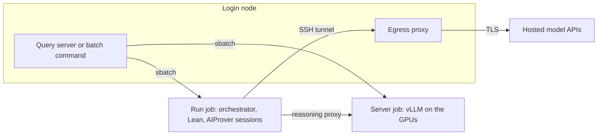

# Running on a Slurm cluster

A cluster can run the whole pipeline as Slurm jobs, from the login node. The model server is a GPU job, and each run is a CPU job of its own, so that Lean checks and AIProver sessions use compute nodes and the login node runs nothing heavy. Two interfaces share the same jobs: the query server, which submits the runs of its queue, and a batch command for one run at a time.



## Requirements

The login node of the cluster needs Python 3.11 or later, `git`, `curl`, `uv`, and network access. The compute nodes need none, since every download happens on the login node. The cluster must provide a file system shared by the login and compute nodes, a node-local directory in `SLURM_TMPDIR`, and the commands `sbatch`, `squeue`, `sacct`, and `scancel`. The model server further needs the weights of a model in a directory.

## Installation

The installation consists of three steps, performed once on the login node of a checkout.

1. Fill in `configs/slurm/site.env`, which the checkout provides with empty values. The account is `SBATCH_ACCOUNT`, the directory of the weights is `AIPROVER_MODEL`, and the GPUs of the server job are `AIPROVER_GPUS`, written as sbatch writes them, for example `a100:4`. The server job then takes whole nodes with these GPUs. From these values the code defines one GPU group for the model, so that no further file is needed. A deployment that keeps its values out of the repository places an untracked `configs/site.env` beside the template, which replaces it.
2. Run `bash scripts/slurm/setup.sh`. The script creates the virtual environments, including one with vLLM for the model, fetches the harness and the Lean project with the prebuilt files of Mathlib, and then submits CPU jobs that build the Lean project and pack it. A pack is a set of tar shards, made by `scripts/slurm/pack.sh`, that a job extracts to node-local disk. Shared file systems serve a few large files much faster than the many small files of Mathlib, so a run job works on its extracted copy. The option `--claude` additionally installs the `claude` command for runs with Claude roles.
3. After the jobs have finished, which `squeue --me` shows, prepare the command line client of each hosted provider that the roles use, for example by logging in once, because compute nodes share the home directory of the login node. Runs whose roles all use the AIProver server need no client.

A Lean release other than the pinned one, such as the one given to `--lean-release`, is installed in two phases, because compute nodes have no network. The command `python -m aiprover_orchestration.lean.releases RELEASE fetch` downloads on the login node, `sbatch --wrap 'python -m aiprover_orchestration.lean.releases RELEASE build'` builds in a CPU job, and `pack.sh` packs the result like the default project. Without `--lean-release`, a run uses the pinned release that `setup.sh` installs.

## Running

After `source scripts/slurm/env.sh`, which selects the Slurm executor, the site files, and the paths of the checkout, the batch command submits one run. If no server job of the run's GPU group exists, it submits that job as well, and the run job then starts after it and waits until the model answers.

```bash
source scripts/slurm/env.sh

# A problem of a dataset, with every role on the AIProver server.
python -m aiprover_orchestration.server.slurm submit \
    --problem-uuid OpenAIMath_164_HindmanDistinctExpressions \
    --config configs/orchestrator/open.json

# A problem given as files, with an optional proof and Lean statement.
python -m aiprover_orchestration.server.slurm submit \
    --statement problem.tex --proof proof.txt --config configs/orchestrator/open.json

# The same problem built on a library, then followed and stopped by run id.
python -m aiprover_orchestration.server.slurm submit --statement problem.tex \
    --library libraries/base.lean --config configs/orchestrator/open.json
python -m aiprover_orchestration.server.slurm cancel RUN_ID
```

The option `--resume RUN_ID` continues a run from its trace, and `--lean-release RELEASE` selects an installed release. Arguments after `--` go to the orchestrator unchanged, as with `python -m aiprover_orchestration.orchestrator.run`, which the job executes. The statement files are read where the job runs, so they lie on the shared file system. The configuration `configs/orchestrator/open.json` places every role on the AIProver server, whereas `configs/orchestrator/standard.json` uses Claude for the orchestrator roles. The `base_url` of the first configuration names the reasoning proxy port 18575, which is the `proxy_port` of the default group, so that a site that changes the port changes the configuration as well. The progress of a run is written to `temp/RUN_ID.out` and its results to `results/RUN_ID/`.

A library is either a single Lean file or a Lake package, as described in `aiprover_orchestration/orchestrator/libraries.py`. A single file is read by the run directly. A package is built beforehand against the Lean release of the run, and the run job then finds its modules through `LEAN_PATH`, which `--library` sets from the package directory. Because the build is read from the shared file system by every Lean check, a large package should be built once and packed like the Lean project.

## The web server

The query server and the Slurm jobs form one system. The server keeps the queue of requests in its database, and its worker submits each run as a job when `AIPROVER_RUN_EXECUTOR=slurm`, which `env.sh` sets. A run started from the page therefore carries the same options as one started from the batch command: the problem or the uploaded files, the library, the Lean release, and the roles chosen on the form. The worker follows each job by its id, shows its state and trace on the page, cancels it on request, and resumes a run whose job ended at the wall time or with its node.

```bash
source scripts/slurm/env.sh
aiprover/venv_tools/bin/python -m uvicorn aiprover_orchestration.server.app:app --port 8443
```

The environment `aiprover/venv_tools`, which `setup.sh` creates, provides `uvicorn`, so that the system Python of the login node is not used. The server runs on the login node and does no heavy work itself. The page offers the GPU groups of the site, and the worker starts and stops their server jobs through the same `sbatch` and `scancel` calls. Only one model server per run is managed by the server, whereas the additional groups of a run are submitted by the batch command.

## Jobs

A run job first waits for the model server named in the handoff file of its group. It then starts a reasoning proxy on a free local port, because several jobs may share a node, points the configs of the run at the proxy, and sets the compaction threshold of the harness to 70 percent of the context that the server reports. It extracts the Lean project to node-local disk and builds the modules of the run there. Compute nodes reach no external host, so a run with Claude or Codex roles opens an SSH session to the login node that submitted it. That session starts an egress proxy, which relays TLS only to the hosts that the roles of the run call and exits with the session. Finally, the job runs the orchestrator and forwards SIGTERM to it, including the warning that Slurm sends ten minutes before the wall time, so that the trace records the interruption. The outcome of the job is written to `temp/RUN_ID.slurm.json`.

| Variable | Meaning |
|---|---|
| `AIPROVER_RUN_EXECUTOR` | `local` (default) or `slurm` |
| `AIPROVER_SLURM_RUN_ARGS` | sbatch options of run jobs (default `--cpus-per-task=16 --mem=64G --time=24:00:00`) |
| `AIPROVER_SERVER_WAIT` | seconds that a run job waits for its model server (default 3600) |
| `AIPROVER_SERVER_ARGS` | sbatch options of the server job, such as the GPU type |
| `AIPROVER_EGRESS` | `ssh` (default) reaches hosted models through the login node; `direct` leaves the network of the job unchanged, for nodes with internet access |
| `AIPROVER_PACK_ROOT` | directory of the packs, if they do not lie beside their sources |
| `AIPROVER_LEAN_PROJECT` | the Lean project of the harness |
| `SBATCH_ACCOUNT` | account of all jobs, read by sbatch |

## Adapting to a site

The values of `site.env` cover one model on one GPU type. A different GPU type changes only `AIPROVER_GPUS`, for example `h100:8`, and `AIPROVER_SERVER_ARGS` replaces the sbatch options of the server job when it should not take whole nodes. The server job uses every GPU of its node for tensor parallelism, copies the weights to node-local disk, and writes the node, port, and served name to a handoff file, from which run jobs address it.

A deployment with several groups, a chat model beside the prover, or a price per GPU hour defines the site in `configs/site.json` instead, which replaces the default site. The file lists `cluster` (the partition, the node count, the wall time, and the model directories by name under `checkpoints`), `groups`, and `hardware`. A group names its Slurm job (`job_name`), its handoff file (`handoff`), its harness config (`prover_config` and `tunnel_config`), its reasoning proxy port (`proxy_port`), its model (`checkpoint`), and the environment of its server job (`server_env`). A group with a `checkpoint` and a `server_env` but no harness config serves a chat model for the roles that name it with `"group"`.

A checkpoint with `params.json` is served in the Mistral format. Any other checkpoint is served with the tool-call parser `TOOL_CALL_PARSER` (default `hermes`) and the reasoning parser `REASONING_PARSER`, if one is set. The served name, context length, and further vLLM options are set by `SERVED_NAME`, `MAX_MODEL_LEN`, and `EXTRA_ARGS`, and the `server_env` of a group holds these variables, so that each group serves its own model.

## Placing the models of a run

The roles of a run configuration select a backend each, and the backends determine where the model executes.

| Role specification | Execution |
|---|---|
| `"backend": "aiprover"` | The harness of the run job, against the server of the run's group through a reasoning proxy. |
| `"backend": "openai_compatible"` with the served name of the group's model and the group's endpoint as `base_url` | The same server, through the same proxy. |
| `"backend": "openai_compatible"` with `"group": "NAME"` | A chat model on the GPU group NAME, which has a `checkpoint` and a `server_env` but no harness config. The batch command submits one server job per group, and the run job addresses each server directly. |
| `"backend": "claude"` or `"codex"` | The provider's API, through the egress session. |
| `"backend": "openai_compatible"` with a `base_url` outside the cluster | The API at that host, through the egress session, which allows the host of the address. A key file is named by `api_key_file`. |

A configuration in which every role uses the AIProver server, such as `configs/orchestrator/open.json`, runs without any hosted model and opens no egress session. A configuration that places the orchestrator on a second group serves an open-weight chat model beside the prover. The orchestrator then has no Lean tools unless its backend provides them, because tools are an option of the hosted backends only.

The query server follows a single model server per run, that of the group named in the request. A run job started by the query server waits for the additional groups of its configuration as long as `AIPROVER_SERVER_WAIT` allows, and the batch command submits them. Clusters whose compute nodes cannot connect to the login node over SSH require `AIPROVER_EGRESS=direct` and compute nodes with internet access to use hosted models.
