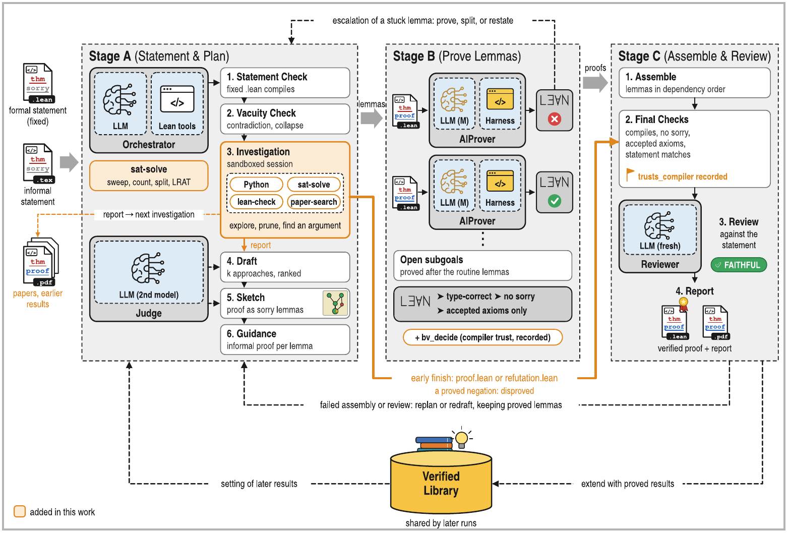
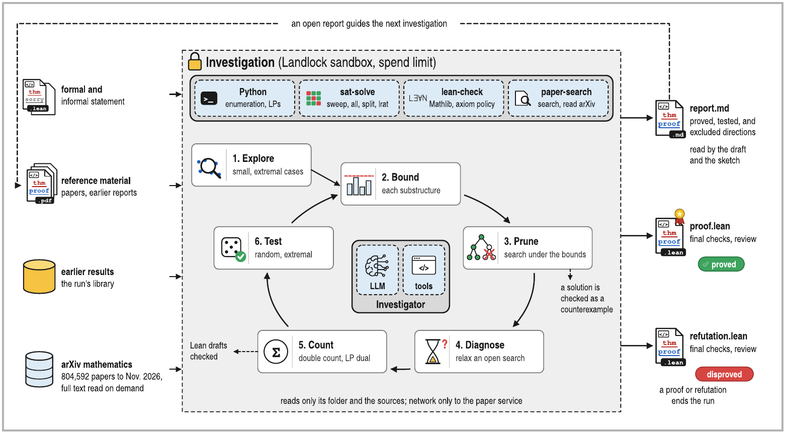

# SAT search and investigation in the orchestration

## Summary

The orchestration proves a theorem by decomposing it into lemmas, which presupposes that each lemma has a proof idea. A lemma whose truth is a fact about a finite space may have no proof shorter than its search. This work added two capabilities. The first is SAT search: proofs may use `bv_decide`, which checks a solver certificate and trusts the Lean compiler, and the orchestrator may run `sat-solve` for sweeps over sizes, counts of solutions, timed case splits, and certificates that the kernel checks on the standard axioms. The second is an investigation stage: before the informal draft, a sandboxed session with Python, `lean-check`, `sat-solve`, the literature search, and reference material explores the problem, and a complete Lean proof or refutation that it writes ends the run after the final checks and the final review.

On unpublished finite cores the SAT tools decided outcomes that the orchestrator without them could not reach. Applied to the game SET, the work proved in Lean, on the standard axioms, M(n, 3) = M(n, 4) for every 13 ≤ n ≤ 27, which settles the conjecture of the source preprint, and the bound of Kaplan's Conjecture 2012.1 for at most 27 points in every dimension. Applied to Tarski's high school identities, two investigations showed that no four-element HSI algebra is a Gurevič algebra, given Wilkie's HSI theorem, which raises the lower bound on the smallest Gurevič algebra from four to five. Paired comparisons with a single confined session given the same sources show that the architecture was not needed for the SET results, which such a session also proved, whereas the four-element Gurevič result rests on an idea that the single session did not find.

## Overview of the orchestration in mode prove

Figure 1 (`icml2026/figures/prove_overview.pdf`) shows the orchestration on a fixed statement, with the components added in this work drawn in orange. The inputs on the left are the formal statement, a Lean file whose theorem ends in `sorry` and which the run never revises, the informal statement, and reference material such as papers and the reports of earlier investigations.



*Figure 1. The orchestration in mode prove; components added in this work are orange.*

Stage A (Statement & Plan) is carried out by the orchestrator, a model with Lean tools, and the judge, a second model that rates the drafts and sketches. Every orchestrator call may run `sat-solve`, with its four modes (sweep, count, split, and LRAT certificate). The statement check compiles the fixed statement, and the vacuity check looks for contradictory hypotheses or a collapsed structure and proves facts about the setting that later lemmas may cite. The investigation, a sandboxed session described below and in Figure 2, then explores the problem, and its report reaches the draft. The draft gives k informal approaches, which the judge ranks; the sketch turns the chosen approach into a Lean proof whose lemmas end in `sorry`; and the guidance gives each lemma an informal proof for its prover jobs.

Stage B (Prove Lemmas) sends each lemma to several AIProver sessions, each a prover model with its harness, whose attempts Lean accepts or rejects. Lemmas marked as open subgoals are attempted after the routine ones. Lean accepts a lemma when its proof is type-correct, contains no `sorry`, and depends only on the accepted axioms; with the option `bv_decide`, the accepted axioms include those of the compiler, and the run records this trust. A lemma that stays unproved returns to the orchestrator as an escalation, which may prove it, split it, or restate it, again with `sat-solve`.

Stage C (Assemble & Review) assembles the proved lemmas in dependency order and applies the final checks: the file compiles, contains no `sorry`, uses only the accepted axioms, and states the given theorem; the flag `trusts_compiler` records a proof that relies on `bv_decide`. A reviewer, a fresh model without the run's history, compares the verified file with the statement, and a run is proved only with the verdict FAITHFUL. The run ends with the verified Lean file and a report.

Four paths connect the stages. The early finish, the long orange arrow, takes a complete proof (`proof.lean`) or refutation (`refutation.lean`) from the investigation directly to the final checks, so that the lemma pipeline is skipped; a proved negation ends the run as disproved. A failed assembly or review returns to Stage A, which replans or redrafts while keeping the proved lemmas. An investigation that reports no complete argument ends the run with status `investigation_open`, and its report becomes reference material for the next investigation. The verified library supplies the setting of later results and is extended with each proved result, so that later runs build on earlier ones.

## SAT search

The solver is an oracle for search only: none of its answers changes the trusted state until Lean accepts a proof that the answer suggested (Table 1). The orchestrator writes each encoding during the run, so generated code never lies on the trust path, and an encoding that misrepresents the statement yields a proof that fails its check. Compiled evaluation is confined to `bv_decide`: submitted text may not use `native_decide`, `decide +native`, `implemented_by`, `extern`, or the names of the compiler axioms.

*Table 1. Solver answers and their route into Lean.*

| Answer | Route into Lean | Axioms beyond the standard three |
| --- | --- | --- |
| Satisfiable | The assignment as a witness or counterexample, checked by `decide` | None |
| Unsatisfiable, small space | `decide +kernel` over the finite type | None |
| Unsatisfiable, moderate certificate | Mathlib's `lrat_proof`, checked by the kernel | None |
| Unsatisfiable, large space | `bv_decide` on the finite core as a Boolean formula | `Lean.ofReduceBool`, `Lean.trustCompiler` |

`sat-solve` (`aiprover_orchestration/sat/sat_solve.py`) runs CaDiCaL from the Lean toolchain on a DIMACS file or on a sandboxed Python script that prints one, so that one encoding serves many sizes. Its modes are `--sweep A..B` (thresholds and smallest counterexamples), `--all K` (counts and uniqueness), `--split x,y,...` (timed cases, for designing splits), and `--lrat NAME` (a file with Mathlib's `lrat_proof` for an unsatisfiable formula; certificates above 200 MB are discarded to bound disk use). The options `bv_decide` and `sat_search` are off by default; with `bv_decide` the run's checks accept the compiler axioms and record `trusts_compiler`. Of three routes for checking certificates, a kernel checker written with lists fails beyond about twenty thousand hints, `lrat_proof` reaches several hundred thousand at a cost in memory, and `bv_decide` is fastest at scale (Table 2).

An encoding is a short script that the orchestrator writes during the run. The following one asks whether the numbers 1 to n can be coloured with two colours so that no three-term arithmetic progression is monochromatic; variable i is true when i has the first colour, and each progression contributes two clauses.

```python
import sys

n = int(sys.argv[1])
# Variable i is true when the number i has the first colour.
progressions = [(a, a + d, a + 2 * d)
                for d in range(1, n) for a in range(1, n - 2 * d + 1)]
print(f"p cnf {n} {2 * len(progressions)}")
for i in range(1, n + 1):
    print(f"c var {i} x{i}")
for a, b, c in progressions:
    print(f"{a} {b} {c} 0")      # not all three in the second colour
    print(f"-{a} -{b} -{c} 0")   # not all three in the first colour
```

A sweep finds the threshold, a single call returns a witness by the variable names, and `--lrat` turns the first unsatisfiable size into a Lean file:

```text
$ sat-solve vdw.py --sweep 5..10
5: SATISFIABLE (0.1 s)
...
8: SATISFIABLE (0.1 s)
9: UNSATISFIABLE (0.1 s)
10: UNSATISFIABLE (0.1 s)
$ sat-solve vdw.py 8
SATISFIABLE (0.1 s)
x1 = false
x2 = false
x3 = true
...
$ sat-solve vdw.py 9 --lrat vdw9
UNSATISFIABLE (0.6 s); wrote vdw9.lean ...
```

The file contains the formula and CaDiCaL's certificate, which Mathlib's `lrat_proof` checks in the kernel:

```lean
lrat_proof vdw9
  "p cnf 9 32 1 2 3 0 -1 -2 -3 0 2 3 4 0 ... 1 5 9 0 -1 -5 -9 0"
  "33 -6 -8 -9 0 22 30 5 3 28 0 34 -8 -9 0 ... 48 0 46 47 42 3 0"
-- 'vdw9' depends on axioms: [propext, Classical.choice, Quot.sound]
```

The theorem `vdw9` states that every assignment of the nine variables falsifies some clause. The orchestrator then proves in Lean that a colouring without monochromatic progressions yields an assignment satisfying every clause, which connects the certificate to the statement; an encoding that misrepresents the statement leaves this step unprovable, so the encoding itself is never trusted. For larger formulas the same finite core is stated as a Boolean formula over bit vectors and proved by `bv_decide`.

*Table 2. Seconds to check a CaDiCaL certificate in Lean.*

| Formula | Hints | Kernel checker | `lrat_proof` | `bv_decide` |
| --- | --- | --- | --- | --- |
| Pigeonhole, 7 into 6 | 16,729 | 280 | 14 | 8 |
| Pigeonhole, 8 into 7 | 123,200 | fails | 107 (6.4 GB) | 17 |
| Pigeonhole, 9 into 8 | 634,124 | fails | 724 (32.6 GB) | 34 |

## Evaluation of the SAT tools

Single orchestrator calls with Lean tools, configured as escalations, received the Lean definitions and a statement that might be true or false, with no informal proof or hint. The arms were base (neither option), bv (`bv_decide`), bvsat (both), and sat (`sat-solve` on the standard axioms). On nineteen lemmas about colorings that avoid unusual patterns, whose answers are unpublished, 161 calls gave Table 3.

*Table 3. Unfamiliar finite cores: replies accepted in Lean, and mean minutes of the accepted replies.*

| Kind | Base | bv | bvsat | sat |
| --- | --- | --- | --- | --- |
| Two colors, unsatisfiable or witness | 8 of 10; 5 | 10 of 10; 2 | 10 of 10; 3 | 2 of 2; 13 |
| Three colors, unsatisfiable | 0 of 10 | 9 of 10; 17 | 8 of 10; 17 | 0 of 2 |
| Three colors, witness | 1 of 10 | 9 of 10; 10 | 10 of 10; 1 | 2 of 2; 1 |
| Counts of colorings | 11 of 11; 17 | 9 of 11; 11 | 11 of 11; 6 | |
| Smallest counterexample over all sizes | 3 of 3; 19 | 3 of 3; 7 | 3 of 3; 4 | |
| Thresholds | 3 of 7; 13 | 7 of 7; 14 | 7 of 7; 8 | 0 of 2 |

Without `bv_decide` the orchestrator settled almost none of the three-color cores; with it nearly every lemma was settled, and where one call did not finish, it broke the color symmetry, chose a split with `--split`, and proved each case by `bv_decide`. `sat-solve` changed time more than outcome. A full run with both options and the AIProver model as prover proved its theorem, and the AIProver model used `bv_decide` without having received the note.

## The investigation stage

Figure 2 (`icml2026/figures/investigation.pdf`) shows the investigation, which runs before the informal draft in mode prove with the option `investigation_usd` as its spend limit. Its inputs, on the left, are the formal and informal statements, the reference material (papers and earlier reports, from the orchestrator's `source_dir`), the earlier results of the run's library, and an index of 804,592 arXiv mathematics papers through November 2026, whose full texts the session reads on demand.



*Figure 2. The investigation: inputs, the sandboxed tools, the method cycle, and the outputs.*

The session reuses the sandboxed session of the project research tasks. A Landlock sandbox lets it read only its own folder and the sources, and the only network access is to the paper service. Four tools stand along the top of the figure: Python for enumeration and linear programs, `sat-solve` with its modes `--sweep`, `--all`, `--split`, and `--lrat`, `lean-check` against Mathlib under the run's axiom policy, and `paper-search` for searching and reading arXiv.

The prompt describes a method, which the cycle in the centre depicts, and leaves the answer to the investigator. The six numbered phases are as follows.

1. Explore. The investigator computes small cases, boundary cases, and extremal objects with Python, and reads the reference material and the literature with `paper-search`, to learn what the true values are and which objects attain them.
2. Bound. It bounds the quantity of the theorem on each substructure of a symmetric family, such as each direction, colour class, coordinate, or case, so that a global statement becomes a conjunction of local constraints.
3. Prune. It turns these bounds into constraints that any counterexample must satisfy and searches for one under them with `sat-solve`. A solution of the pruned search is checked as a candidate counterexample; an unsatisfiable answer, with its certificate, is a proof for that size.
4. Diagnose. When a search stays undecided, it relaxes the formula, dropping the objective or groups of constraints, to find which part makes it hard. A formula that stays hard after the objective is dropped indicates that the remaining constraints contradict each other.
5. Count. It looks for that contradiction by double counting a quantity over the whole symmetric family, or by solving a linear program over the constraints and reading a proof from its dual certificate. Lean drafts of the argument are checked with `lean-check`, and a complete proof is written as `proof.lean`.
6. Test. It evaluates every conjectured identity or inequality on random and extremal instances before the report relies on it, records the test, and returns to the bounds with what it has learned.

The pruning search was tried on three problems.

- On SET it was decisive for M(17, 4) ≤ 30, through the following steps.
  1. The search sought a configuration of 17 points of F₃⁴ with 31 SETs.
  2. Each of the 40 directions of F₃⁴, given by a linear functional up to sign, splits the points into three level sets. A SET either lies inside one level set or meets all three.
  3. The SETs inside a level set are bounded by the known values for F₃³, and the transversal ones by the level sizes. At 31 SETs this leaves only five admissible level patterns in every direction.
  4. The pruned formula requires one of these patterns in each of the 40 directions. It stayed undecided after hours.
  5. The relaxation that kept only the pattern constraints, dropping the requirement of 31 SETs, stayed undecided as well, which located the difficulty in the patterns themselves.
  6. A linear program over the number of directions with each pattern is infeasible at 31 SETs. Its dual certificate gives the identity Σ_ξ (5e₂ − p − 300) = 240 − 18L, from which the bound follows by summation over the directions.
  7. Later investigations adapted the constants to every n from 18 to 27, at 0.47 to 3.37 USD per size, and the same projection and counting steps proved Kaplan's conjecture for at most 27 points in every dimension (Table 4).

  The search itself proved nothing; its failure, read through the diagnosis, located the counting argument that did.
- On the Kochen–Specker problem pruning paid directly: forbidding vertices of degree three in the orthogonality graphs reduced a search at order 16 from 98 to 0.9 seconds.
- On the rank of 3×3 matrix multiplication over F₂ the same steps ended negatively. Direct SAT encodings stayed undecided already at rank 9, and the linear program of hyperplane counting showed that this route cannot exceed rank 16.

The outputs, on the right, are three files. The report `report.md` separates what is proved, what is only tested, and the directions excluded, and it begins with a line stating whether it contains a complete argument. A report with an argument is read by the draft and the sketch; a report without one ends the run, and the dashed arrow at the top carries it to the next investigation, as when the first four-element investigation of the high school identities guided the second. A complete Lean proof written as `proof.lean`, or a proof of the negation written as `refutation.lean`, passes the final checks of an assembled proof and the final review, and the run then ends as proved or disproved without the lemma pipeline. Tests cover each path (`tests/test_investigation.py`).

## Application to SET

A card with k properties is a point of F₃ᵏ, and three cards form a SET exactly when they are distinct points with sum zero. A recent preprint determines M(n, 4) for n ≤ 16 from the values M(n, 3) = 16, 19, 23, and 26 for 13 ≤ n ≤ 16, which rest on an exhaustive computer search, and conjectures that M(n, 4) = M(n, 3) beyond. The question is older: Kaplan posed it at the 2012 Combinatorial and Additive Number Theory problem session as Conjecture 2012.1, that the maximum number of lines among m points of F₃ⁿ is attained in F₃ᵈ with d = ⌈log₃ m⌉, and it is still listed as open in the 2025 collection ([arXiv:1406.3558](https://arxiv.org/abs/1406.3558)). Stevens and Wilson determined the maxima with four properties for n ≤ 12 ([arXiv:2501.12565](https://arxiv.org/abs/2501.12565)), and a search of the web and of the arXiv index through mid-November 2026 found no result for n ≥ 17. Every result in Table 4 keeps the given definitions and statement, compiles on the standard axioms, and was audited independently by compiling the standalone file with `#print axioms`.

*Table 4. Results on SET in Lean.*

| Points | Statement | Route | Cost per case |
| --- | --- | --- | --- |
| 13–16 | M(n, 3) ≤ 16, 19, 23, 26 | Single calls, four arms; 15 of 16 accepted | |
| 13–16 | M(n, 3) = M(n, 4) = 16, 19, 23, 26, both bounds, both dimensions | Investigation, early finish, final review faithful | 1.87–2.62 USD |
| 17 | M(17, 4) ≤ 30 | Full run from the statement alone, 39 lemmas (29 by AIProver) | 9.19 USD |
| 17–27 | M(n, 4) ≤ 30, 36, 41, 47, 54, 62, 71, 81, 92, 104, 117 | Investigations | 0.47–3.37 USD |
| 17–27 | Matching lower bounds, explicit configurations | Investigation, early finish | 0.36 USD |
| m ≤ 27 | At most M(m, 3) lines among m points of F₃ⁿ, every n | Investigation, early finish, final review faithful | 8.86 USD |

The proofs for three properties on the standard axioms use no search: they count pairs and triples within the parallel planes of each direction of F₃³. The full run on 17 cards counted zero-sum triples over the 81 linear functionals of F₃⁴ and bounded the SETs of each functional by those inside its three level sets and the transversal ones. That bound prunes a search for a counterexample: a configuration with 31 SETs must have one of five level patterns in every one of the 40 directions. The pruned search, and even the formula that kept only the pattern constraints, stayed undecided after hours, which indicated that the constraints contradict each other by counting. The investigation set up a linear program over the number of directions with each pattern, found it infeasible at 31 SETs, and turned its dual certificate into a short proof, Σ_ξ (5e₂ − p − 300) = 240 − 18L over the 40 directions; later investigations adapted the constants for each n. The general theorem for m ≤ 27 proceeds by induction on the dimension: a counting inequality shows that a set with more than M(m, 3) lines in dimension at least five leaves some difference vector unused, projection along that vector keeps every line, and the cases of F₃³ and F₃⁴ close the induction. Together with the earlier values, these results settle the preprint's conjecture and Kaplan's conjecture for at most 27 points, in every dimension; for m ≤ 9 the latter also uses the standard equality of the planar and three-dimensional maxima. The runs are gathered in the project `set_game_f3`, and the general theorem has a reviewed informalization of 15 pages (`results/kaplan27_01/informal/`).

## Application to the high school identities

An HSI algebra satisfies Tarski's eleven high school identities, and it is a Gurevič algebra if it fails some equation valid in the positive integers. Alsulami, Jackson, and Kinyon proved that every multiplicatively idempotent HSI algebra and every HSI algebra with at most three elements satisfies all equations of ℕ, and they left open the 60 four-element HSI algebras that are not multiplicatively idempotent ([arXiv:2609.16922](https://arxiv.org/abs/2609.16922)); the known range for the smallest Gurevič algebra was four to twelve elements. A first investigation (7.78 USD) settled 33 classes by elementary arguments, finite certificates over quotients of ℕ and infinite models, and proved that no finite certificate exists for the remaining ones. A second investigation (10.02 USD), given the first report, settled all 60 through a criterion on the semiring reduct: the laws that Wilkie's HSI theorem adds involve no exponentiation, so an algebra whose {+, ·, 1}-reduct is a homomorphic image of a semiring closed under all positive polynomials satisfies every equation of ℕ. The reducts fall into 29 types, each with an explicit homomorphism, and the classification into 60 classes was computed three times independently, once by a SAT encoding whose unsatisfiability certifies completeness. Every homomorphism was checked against the tables of all 60 classes on 20,000 random pairs, without failure. Given Wilkie's theorem, on which the earlier results also rest, no HSI algebra with at most four elements is a Gurevič algebra, so the smallest one has between five and twelve elements. The paper is in `results/gurevic4_03/paper/`.

A third investigation addresses five elements. It reproduced the counts of 13,577 classes, 11,158 of them idempotent, and grouped the 2,419 others by their 364 semiring reducts. A finite test of the multiplicative form of the criterion passes for 356 reducts and fails for 8, covering 38 classes that admit no expansion to Wilkie's laws. Of these, 4 are settled elementarily and 7 through finite quotients of a model built on dual numbers, a + bε with ε² = 0 and exponentiation by the real part, which lies in the variety of ℕ given Wilkie's theorem; the remaining 27, with a nilpotent element or an absorbing element, are the candidates for a five-element Gurevič algebra, and searches over Wilkie-type identities have found no failing equation in them so far.

## Other investigations

For the minimum Kochen–Specker system in ℝ³, whose size lies between 24 and 31, an investigation proved the reduction to minimal systems and their squarefree orthogonality graphs and measured candidate pruning constraints at order 16: forbidding vertices of degree three reduces the time from 98 to 0.9 seconds, whereas constraints on edge or triangle counts give no gain. It also exhibited squarefree, non-colourable, vertex-critical graphs with one to eight vertices of degree three on 19 to 21 vertices, verified independently, which rules out any graph-level lemma bounding such vertices; a reduction of the order-24 search therefore requires a geometric argument. For the rank of 3×3 matrix multiplication over F₂, an investigation proved a capacity lemma giving rank at least 16, showed by linear programming that hyperplane counting cannot exceed 15.75, and found direct SAT encodings undecided already at rank 9, which places the claimed bound of 23 beyond a single session.

Since the bound over F₂ is claimed elsewhere with certificates that our resources cannot replay, we recommend using the problem as a testbed for the SAT tooling instead of as a target. Its formulas are small, have a symmetry group of order 56,448, and include instances whose answers are known: the Brent equations for ⟨3,2,3⟩ have rank 15 by Hopcroft and Kerr, yet the solver found decompositions at ranks 17 and 18 within 15 seconds and none at rank 15 within 600 seconds, and the hyperplane relaxation of ⟨3,3,3⟩ is feasible at rank 22, bounded below by 15.75 through linear programming, and undecided at rank 16 after 800 seconds. Paired measurements on these instances, with and without symmetry breaking and with the case splits that `--split` proposes, would quantify how much each technique reduces solving time on formulas of this kind, and the result would inform the notes given to the orchestrator and the prover.

## Comparison with a single session

To separate the contribution of the architecture, a confined Claude Code session with Lean, Python, and the arXiv search, and without orchestration, investigation, or SAT tooling, received each problem's formal statement and only the published sources (benchmark condition `lean_research`). Table 5 compares its outcomes with those of the architecture.

*Table 5. A single confined session against the architecture.*

| Problem | Single session | Architecture |
| --- | --- | --- |
| M(17, 4) ≤ 30 | Proved, 699 lines, 4.98 USD, 27 minutes | Proved by a full run, 9.19 USD, and by an investigation, 3.37 USD |
| Kaplan's conjecture, m ≤ 27 | Proved, 720 lines, 5.24 USD, 35 minutes | Proved, 8.86 USD, after earlier runs on F₃⁴ |
| Four-element HSI algebras | 32 classes Lean-verified, 14 via Wilkie on paper, 14 open; 18.14 USD | All 60 via Wilkie on paper, no Lean; 17.80 USD over two investigations |

On SET the single session matched or exceeded the architecture at similar cost, finding the same counting arguments, so those results do not depend on the architecture. On the high school identities the two-stage investigation settled the 14 classes that the single session left open, through the criterion above, whereas the single session produced kernel-checked proofs for 32 classes, which the investigations did not attempt; a single investigation alone settled slightly fewer classes than the single session. The advantage observed therefore lies in iterating investigations on earlier findings rather than in one investigation.

## Related work

Systems for automated proof in Lean decompose proofs into lemmas and equip agents with retrieval, premise selection, and Lean feedback ([arXiv:2512.17260](https://www.emergentmind.com/papers/2512.17260); [arXiv:2510.01346](https://arxiv.org/pdf/2510.01346); [arXiv:2510.12787](https://arxiv.org/html/2510.12787v3); [arXiv:2506.19923](https://arxiv.org/pdf/2506.19923)); none reports a SAT solver among the tools of an agent. Hammers translate goals to first-order provers and SMT solvers ([LeanHammer](https://cmu-l3.github.io/lean-hammer); [arXiv:2505.15796](https://arxiv.org/pdf/2505.15796)). Verified SAT results in combinatorics connect objects to encodings written by experts and check certificates in or for Lean ([arXiv:2403.17370](https://arxiv.org/abs/2403.17370); [arXiv:2607.00815](https://arxiv.org/html/2607.00815)). Automated lower-bound frameworks for bilinear complexity over finite fields classify subspaces under a symmetry group and emit certificates that an independent verifier rechecks ([arXiv:2603.07280](https://arxiv.org/abs/2603.07280)); such frameworks are built by experts for one family of problems. Recent results on matrix multiplication were also found with language models assisting a human author, and some were then formalized in Lean ([arXiv:2609.14393](https://arxiv.org/abs/2609.14393); [arXiv:2609.22054](https://arxiv.org/abs/2609.22054)).

The present work differs from these in where the search and its trust reside. The orchestrator writes each encoding and its connection to the statement during the run, so that no encoding is trusted: a solver answer enters the result only as a proof that Lean accepts. Exploration with `sat-solve` is kept apart from the proving tactic, and trust in the compiler is confined to `bv_decide` and recorded in the result. The investigation adds a stage that none of the surveyed systems has: a sandboxed session that uses search to learn about the problem before any plan exists, diagnoses an undecided search by relaxing it, and turns the diagnosis into a counting argument or the dual certificate of a linear program, as in the proof of M(17, 4) ≤ 30. Its complete proofs pass the same final checks and independent review as an assembled proof, and its reports feed later investigations, which is how the four-element case of the high school identities was settled. The results on SET and on Kaplan's conjecture were obtained from the formal statement and the published sources alone, kept the given statement, and compile on the standard axioms, and paired comparisons with a single session given the same sources separate the contribution of the architecture from that of the underlying model.

## Status

Done:

- `sat-solve` with its four modes and the certificate cap, the `bv_decide` option with confined compiler trust, and their evaluation (161 calls).
- The investigation stage, with the early finish through the final checks and review, the refutation route, the end of a run whose report has no argument, and the literature search over the extended arXiv index.
- Figures 1 and 2 of the orchestration in mode prove and of the investigation.
- SET: M(n, 3) = M(n, 4) for every 13 ≤ n ≤ 27 and Kaplan's conjecture for m ≤ 27 in every dimension, in Lean (Table 4).
- High school identities: no four-element Gurevič algebra, given Wilkie's theorem, with a paper.
- Investigations of the Kochen–Specker problem and of the rank of 3×3 matrix multiplication over F₂, with negative findings.
- Single-session baselines on three problems (Table 5).

In progress:

- The five-element case of the high school identities (run `gurevic5_inv_01`).

To do:

- Formalize the four-element result: the 32 classes already verified by the single session, the classification certificate, the criterion, and the 29 homomorphisms, with Wilkie's theorem as a hypothesis.
- Settle or refute the 27 open five-element candidates.
- Add a write-up step to the investigation, so that an investigation that ends with an argument but no Lean proof produces a reviewed paper-form informal proof.
- Repeat the investigation and the single session on each problem to measure reliability.
- Measure symmetry breaking and case splits on the relaxations of the matrix-multiplication problem, as recommended above.
- Ask the preprint's authors and Kaplan whether they know of other work on M(n, 4) or the conjecture.
- Measure the existing `cdcl` option in a paired test, and generalize refutations from exact statements to the hypothesis patterns that fail.
- Keep the investigation's verified tools in a library for later runs, and add a tool-building role that the orchestrator can call.
- Add a first-order prover inside Lean, such as Duper, beside `bv_decide`.
- Take the lemma list of an informalization from the investigation's proof when a run ends through it.
- Give the AIProver sessions the notes and the command, rename the check `standard_axioms_only`, and keep both SAT options off by default until repeated full runs show their benefit.
